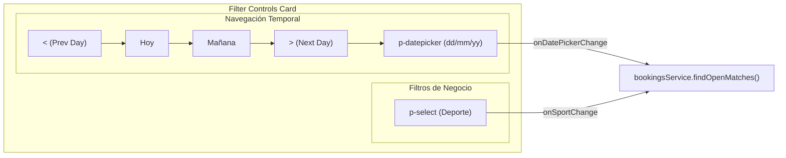

# Diseño Técnico: Adaptación del Header y Barra de Filtros de Partidas Abiertas (`open-matches`)

## 1. Arquitectura y Componentes Afectados
El cambio se circunscribe a la capa de presentación de `spt-portal`:
- `apps/frontend/projects/spt-portal/src/app/pages/open-matches/open-matches.component.ts`: imports de `DatePickerModule`, señales/propiedades `selectedCalendarDate`, `minDate`, métodos de navegación (`prevDay`, `nextDay`, `setToday`, `setTomorrow`, `isPrevDayDisabled`, `isTodaySelected`, `isTomorrowSelected`).
- `apps/frontend/projects/spt-portal/src/app/pages/open-matches/open-matches.component.html`: reemplazo de `.filter-bar-card` por `.filter-controls-card` con dos grupos alineados:
  - Grupo izquierdo: navegación temporal (`nav-step-group` con flechas, botones rápidos y `p-datepicker` compacto).
  - Grupo derecho: filtro de deporte (`sport-filter-wrapper` con `p-select`).
- `apps/frontend/projects/spt-portal/src/app/pages/open-matches/open-matches.component.scss`: estilos homologados con `bookings-grid.component.scss` consumiendo variables del Design System y mixins responsivos.

## 2. Contratos y DTOs
No se alteran contratos de API ni DTOs. Se continúa consumiendo:
- `BookingsService.bookingsControllerFindOpenMatches({ date, sportType })` desde `@core`.
- DTOs oficiales de Orval: `OpenMatchResponseDto`, `OpenMatchResponseDtoSportType as SportType`.

## 3. Evaluación de Riesgo en BBDD
- **Riesgo:** Nulo (0/10). No se modifican entidades Prisma, esquemas SQL, migraciones ni servicios de base de datos.

## 4. Diseño de UI y PrimeNG
- **Componentes PrimeNG utilizados:**
  - `ButtonDirective` (`pButton` con `[outlined]="true"`, `severity="secondary"`).
  - `DatePickerModule` (`p-datepicker` con `[showIcon]="true"`, `[iconDisplay]="'input'"`, `dateFormat="dd/mm/yy"`).
  - `SelectModule` (`p-select` con `[appendTo]="'body'"`, `scrollHeight="320px"`).
- **Estilos:**
  - Reutilización de los patrones consolidados en `bookings-grid`: `.nav-arrow-btn`, `.nav-quick-btn`, `.compact-datepicker`, `.filter-controls-card`.
  - Mixin responsivo `@include mobile-or-tablet` para distribución vertical limpia en pantallas estrechas.
