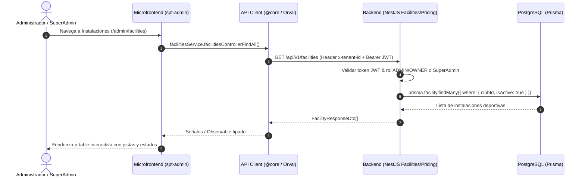

# Design: admin-facilities-pricing (Fase 3)

**Fecha:** 2026-10-20  
**Estado:** 🟡 En Revisión  
**Autor:** Antigravity AI  

---

## 1. Arquitectura y Flujo de Datos



---

## 2. Evaluación de Riesgo en Base de Datos e Integridad

> [!NOTE]
> **EVALUACIÓN DE RIESGO: 🟢 RIESGO NULO / BAJO**
> - Los modelos `Facility`, `FacilityBlock` y `PricingRule` ya fueron creados, migrados e indexados en PostgreSQL durante la **Fase 1**.
> - No se requiere ninguna alteración de esquemas SQL, eliminación de tablas, renombramiento de columnas ni migraciones destructivas.
> - Todos los registros persisten de forma obligatoria `club_id` (UUID) garantizando el aislamiento estricto multi-tenant por centro deportivo.

### Modelos de Prisma Involucrados:
```prisma
model Facility {
  id                 String      @id @default(uuid())
  clubId             String      @map("club_id")
  name               String      @db.VarChar(100)
  sportType          SportType   @map("sport_type")
  courtType          CourtType   @default(OUTDOOR) @map("court_type")
  surfaceType        SurfaceType @default(SYNTHETIC_GRASS) @map("surface_type")
  hasLighting        Boolean     @default(true) @map("has_lighting")
  defaultSlotMinutes Int         @default(90) @map("default_slot_minutes")
  minPlayers         Int         @default(4) @map("min_players")
  maxPlayers         Int         @default(4) @map("max_players")
  isActive           Boolean     @default(true) @map("is_active")
  ...
}

model FacilityBlock {
  id         String   @id @default(uuid())
  clubId     String   @map("club_id")
  facilityId String   @map("facility_id")
  title      String   @db.VarChar(150)
  reason     String?  @db.Text
  startTime  DateTime @map("start_time")
  endTime    DateTime @map("end_time")
  ...
}

model PricingRule {
  id             String     @id @default(uuid())
  clubId         String     @map("club_id")
  facilityId     String?    @map("facility_id")
  sportType      SportType? @map("sport_type")
  name           String     @db.VarChar(100)
  isPeakHour     Boolean    @default(false) @map("is_peak_hour")
  startTime      String?    @map("start_time") @db.VarChar(10)
  endTime        String?    @map("end_time") @db.VarChar(10)
  daysOfWeek     Int[]      @map("days_of_week")
  memberPrice    Decimal    @map("member_price") @db.Decimal(10, 2)
  guestPrice     Decimal    @map("guest_price") @db.Decimal(10, 2)
  lightSurcharge Decimal    @default(0.00) @map("light_surcharge") @db.Decimal(10, 2)
  priority       Int        @default(1)
  ...
}
```

---

## 3. Contratos de API REST (OpenAPI / Swagger)

### A. Módulo `Facilities` (`/api/v1/facilities`)
- `GET /api/v1/facilities`:
  - **Headers:** `Authorization: Bearer <token>`, `x-tenant-id: <uuid>`
  - **Query:** `sportType?: SportType`, `isActive?: boolean`
  - **Response 200:** `FacilityResponseDto[]`
- `POST /api/v1/facilities`:
  - **Body (`CreateFacilityDto`):**
    ```typescript
    {
      name: string; // Min 3, Max 100
      sportType: SportType; // PADEL | TENNIS | FOOTBALL_7 | etc.
      courtType: CourtType; // INDOOR | OUTDOOR | COVERED
      surfaceType: SurfaceType; // CRYSTAL | CLAY | SYNTHETIC_GRASS | etc.
      hasLighting: boolean;
      defaultSlotMinutes: number; // 30 | 60 | 90 | 120
      minPlayers: number;
      maxPlayers: number;
    }
    ```
  - **Response 201:** `FacilityResponseDto`
- `PUT /api/v1/facilities/:id`:
  - **Body (`UpdateFacilityDto`):** Parcial de `CreateFacilityDto` + `isActive?: boolean`.
  - **Response 200:** `FacilityResponseDto`
- `DELETE /api/v1/facilities/:id`:
  - **Response 200:** `{ success: boolean; message: string }`

### B. Módulo `FacilityBlocks` (`/api/v1/facilities/:id/blocks`)
- `GET /api/v1/facilities/:id/blocks`:
  - **Response 200:** `FacilityBlockResponseDto[]`
- `POST /api/v1/facilities/:id/blocks`:
  - **Body (`CreateFacilityBlockDto`):**
    ```typescript
    {
      title: string;
      reason?: string;
      startTime: string; // ISO 8601
      endTime: string;   // ISO 8601
    }
    ```
  - **Response 201:** `FacilityBlockResponseDto`
- `DELETE /api/v1/facilities/:id/blocks/:blockId`:
  - **Response 200:** `{ success: boolean }`

### C. Módulo `Pricing` (`/api/v1/pricing`)
- `GET /api/v1/pricing`:
  - **Response 200:** `PricingRuleResponseDto[]`
- `POST /api/v1/pricing`:
  - **Body (`CreatePricingRuleDto`):**
    ```typescript
    {
      name: string;
      facilityId?: string;
      sportType?: SportType;
      isPeakHour: boolean;
      startTime: string; // "08:00"
      endTime: string;   // "14:00"
      daysOfWeek: number[]; // [1,2,3,4,5] (1=Lunes, 7=Domingo o 0=Domingo)
      memberPrice: number;
      guestPrice: number;
      lightSurcharge?: number;
      priority?: number;
    }
    ```
  - **Response 201:** `PricingRuleResponseDto`
- `PUT /api/v1/pricing/:id`:
  - **Response 200:** `PricingRuleResponseDto`
- `DELETE /api/v1/pricing/:id`:
  - **Response 200:** `{ success: boolean }`

---

## 4. Diseño de UI en Frontend (`spt-admin`)

### 🗺️ Rutas de Navegación en `spt-admin`:
```typescript
export const routes: Routes = [
  {
    path: '',
    loadComponent: () => import('./pages/dashboard/dashboard.component').then(m => m.AdminDashboardComponent),
  },
  {
    path: 'facilities',
    loadComponent: () => import('./pages/facilities/facilities-list.component').then(m => m.FacilitiesListComponent),
  },
  {
    path: 'facilities/:id/blocks',
    loadComponent: () => import('./pages/facilities/facility-blocks.component').then(m => m.FacilityBlocksComponent),
  },
  {
    path: 'pricing',
    loadComponent: () => import('./pages/pricing/pricing-list.component').then(m => m.PricingListComponent),
  },
];
```

### 🎨 Componentes PrimeNG Obligatorios:
- **Tablas:** `<p-table [value]="facilities" ...>` con directiva `pTable`.
- **Botones:** `<button type="button" pButton ...>`.
- **Modales:** `<p-dialog [(visible)]="showDialog" ...>`.
- **Campos de formulario:** `pInputText`, `p-dropdown`, `p-inputnumber`, `p-datepicker` / `p-calendar`, `p-checkbox`.
- **Notificaciones:** `<p-toast>`.
- **Encapsulamiento SCSS:** Modular con `@use "base/responsive" as *;` y variables de `_variables.scss`. Cero `@media` manuales.

---

## 5. Estrategia de Testing

- **Backend (Jest):**
  - `facilities.service.spec.ts`: pruebas de aislamiento de tenant (`clubId`), validación de creación, edición y borrado lógico.
  - `facility-blocks.service.spec.ts`: validación de fechas (startTime < endTime), prevención de solapes de bloqueos.
  - `pricing.service.spec.ts`: comprobación de reglas de cálculo de precios.
- **Frontend (Vitest):**
  - Generación de mocks con `npx orval` hacia `@core`.
  - Pruebas unitarias de componentes (`facilities-list.component.spec.ts`, `pricing-list.component.spec.ts`) validando carga reactiva de datos, apertura de modales y envío de formularios.
