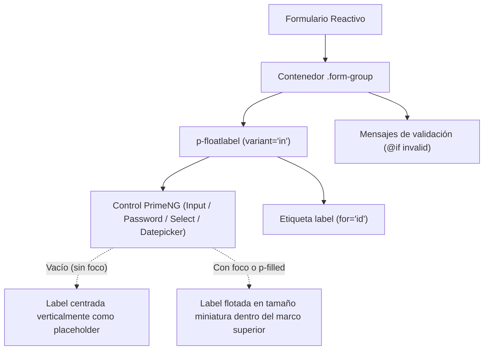

# Diseño: Estandarización Universal de Etiquetas Flotantes (`p-floatlabel variant="in"`)

## 1. Arquitectura de Componentes y UI

### 1.1 Patrón Canónico de Formulario
Cada campo de entrada en un formulario adopta la siguiente arquitectura canónica:

```html
<div class="form-group">
  <p-floatlabel variant="in" class="w-full">
    <input
      pInputText
      id="field_id"
      type="text"
      class="w-full"
      formControlName="fieldName"
      autocomplete="off"
    />
    <label for="field_id">{{ 'I18N.KEY' | translate }}</label>
  </p-floatlabel>
  @if (form.get('fieldName')?.touched && form.get('fieldName')?.invalid) {
    <small class="form-error">
      {{ 'I18N.ERROR_KEY' | translate }}
    </small>
  }
</div>
```

### 1.2 Diagrama de Flujo y Renderizado (Mermaid)



## 2. Modelos Afectados y Dependencias
- **Módulos/Componentes PrimeNG:**
  - `FloatLabel` desde `primeng/floatlabel` (en standalone `imports: [FloatLabel, ...]`).
  - No se requieren librerías de terceros; utiliza la implementación nativa de PrimeNG 22.
- **DTOs y APIs:** Sin impacto en DTOs de backend ni clientes Orval (`@core`), ya que se preserva la semántica de Reactive Forms (`formControlName`, `formGroup`).

## 3. Evaluación de Riesgo en Base de Datos (Regla Crítica)
- **Nivel de Riesgo:** **CERO (0 / NULO)**.
- **Justificación:** Es un cambio estrictamente visual y de plantilla en los componentes frontend de Angular (`apps/frontend/projects/`). No se modifican esquemas Prisma (`schema.prisma`), migraciones SQL, endpoints NestJS, reglas de negocio ni lógica de base de datos multi-tenant (`club_id`).

## 4. Decisiones de Estilos y Design System
- En `_forms.scss`, asegurar que:
  ```scss
  p-floatlabel,
  .p-floatlabel {
    display: block;
    width: 100%;

    &.w-full {
      width: 100%;
    }
  }
  ```
- No se introducen `!important` que interfieran con las clases oficiales de PrimeNG (`.p-floatlabel-in`, `.p-floatlabel-in .p-inputtext`).
