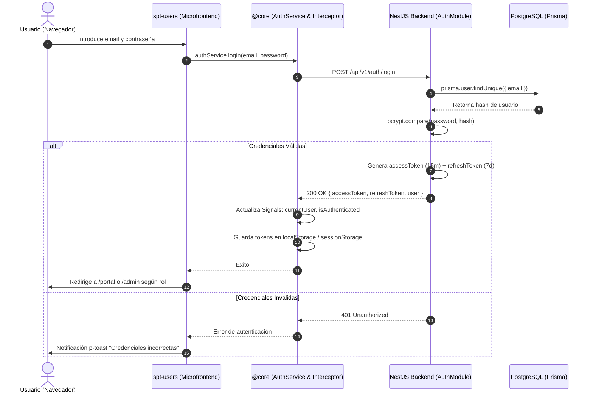
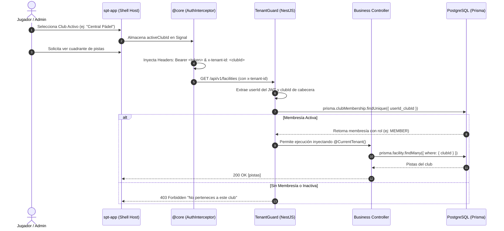

# Design: auth-jwt (Fase 2)

**Fecha:** 2026-10-20  
**Estado:** 🟡 En Revisión  

---

## 1. Diagramas de Flujo y Arquitectura (Mermaid)

### A. Flujo de Autenticación y Emisión de Tokens JWT



### B. Flujo de Resolución Multi-Tenant con `x-tenant-id`



---

## 2. Contratos de la API REST (OpenAPI 3.0 / DTOs)

### Endpoints del Módulo de Autenticación (`/api/v1/auth`)

```yaml
paths:
  /api/v1/auth/register:
    post:
      summary: Registro de nuevo usuario
      tags: [Auth]
      requestBody:
        required: true
        content:
          application/json:
            schema:
              $ref: '#/components/schemas/RegisterRequest'
      responses:
        201:
          description: Usuario registrado exitosamente
          content:
            application/json:
              schema:
                $ref: '#/components/schemas/AuthResponse'
        400:
          description: Error de validación en payload
        409:
          description: El email ya está registrado

  /api/v1/auth/login:
    post:
      summary: Inicio de sesión
      tags: [Auth]
      requestBody:
        required: true
        content:
          application/json:
            schema:
              $ref: '#/components/schemas/LoginRequest'
      responses:
        200:
          description: Login exitoso, retorna tokens de acceso
          content:
            application/json:
              schema:
                $ref: '#/components/schemas/AuthResponse'
        401:
          description: Credenciales inválidas

  /api/v1/auth/refresh:
    post:
      summary: Renovación de Access Token
      tags: [Auth]
      requestBody:
        required: true
        content:
          application/json:
            schema:
              $ref: '#/components/schemas/RefreshTokenRequest'
      responses:
        200:
          description: Nuevo Access Token generado
          content:
            application/json:
              schema:
                $ref: '#/components/schemas/TokenResponse'
        401:
          description: Refresh Token inválido o expirado

  /api/v1/auth/me:
    get:
      summary: Datos del usuario autenticado y membresías
      tags: [Auth]
      security:
        - bearerAuth: []
      responses:
        200:
          description: Perfil completo del usuario
          content:
            application/json:
              schema:
                $ref: '#/components/schemas/UserProfileResponse'
        401:
          description: No autenticado

  /api/v1/users/profile:
    put:
      summary: Actualización de perfil del usuario
      tags: [Users]
      security:
        - bearerAuth: []
      requestBody:
        required: true
        content:
          application/json:
            schema:
              $ref: '#/components/schemas/UpdateProfileRequest'
      responses:
        200:
          description: Perfil actualizado
          content:
            application/json:
              schema:
                $ref: '#/components/schemas/UserProfileResponse'
```

### Definición de Esquemas / DTOs (NestJS + class-validator)

```typescript
// RegisterDto
export class RegisterDto {
  @IsEmail({}, { message: 'El formato de email no es válido' })
  email: string;

  @IsString()
  @MinLength(8, { message: 'La contraseña debe tener al menos 8 caracteres' })
  password: string;

  @IsString()
  @MinLength(2, { message: 'El nombre es obligatorio' })
  firstName: string;

  @IsString()
  @MinLength(2, { message: 'El apellido es obligatorio' })
  lastName: string;

  @IsOptional()
  @IsString()
  phone?: string;
}

// LoginDto
export class LoginDto {
  @IsEmail()
  email: string;

  @IsString()
  password: string;
}

// RefreshTokenDto
export class RefreshTokenDto {
  @IsString()
  refreshToken: string;
}

// UpdateProfileDto
export class UpdateProfileDto {
  @IsOptional()
  @IsString()
  @MinLength(2)
  firstName?: string;

  @IsOptional()
  @IsString()
  @MinLength(2)
  lastName?: string;

  @IsOptional()
  @IsString()
  phone?: string;

  @IsOptional()
  @IsUrl()
  avatarUrl?: string;
}
```

---

## 3. Arquitectura Frontend y Componentes PrimeNG

### Vistas en `spt-users` (Microfrontend Remoto en Puerto 4203)
Todos los componentes son Standalone y utilizan obligatoriamente las directivas PrimeNG requeridas por las directivas de `AGENTS.md`:

1. **`LoginComponent` (`/users/login`):**
   - Tarjeta contenedora con directiva `pCard`.
   - Campo email con directiva `pInputText` y etiqueta flotante `pFloatLabel`.
   - Campo contraseña con directiva `pPassword` (toggle de visibilidad).
   - Botón de envío con directiva obligatoria `pButton` (`label="Acceder"`, `severity="primary"`).
   - Enlace a recuperación y registro con directivas `pButton` (`[text]="true"`).

2. **`RegisterComponent` (`/users/register`):**
   - Formulario de registro con validaciones reactivas de Angular (`ReactiveFormsModule`).
   - Medidor de seguridad de contraseña incorporado en `pPassword`.
   - Botón de envío con `pButton`.

3. **`ProfileComponent` (`/users/profile`):**
   - Panel de datos personales con inputs `pInputText` desactivados/editables.
   - Listado de clubes a los que pertenece el usuario utilizando `pBadge` para mostrar su rol (`ADMIN`, `MEMBER`, `GUEST`).
   - Visualización del monedero virtual por club.

4. **`ClubSelectorComponent` (Modal / Dropdown de Tenant Activo):**
   - Componente selector mediante `pSelect` (o modal `pDialog`) que permite al usuario alternar entre los clubes donde tiene membresía, actualizando reactivamente la cabecera `x-tenant-id` en todas las llamadas API.

---

## 4. Diseño de Estilos, Tokens y Responsive

- **Tokens Semánticos:** Consumo estricto de variables desde `apps/frontend/projects/spt-app/src/styles/base/_variables.scss`:
  - Espaciados: `var(--spacing-md)`, `var(--spacing-lg)`, `var(--spacing-xl)`.
  - Superficies: `var(--surface-card)`, `var(--surface-pure)`, `var(--border-subtle)`.
  - Colores: `var(--primary-color)`, `var(--text-color)`.
- **Mixins Responsivos:** Maquetación móvil y escritorio sin ningún `@media` manual:
  ```scss
  @use "../../../spt-app/src/styles/index" as *;

  .auth-container {
    width: 100%;
    max-width: 440px;
    margin: 0 auto;
    padding: var(--spacing-xl);

    @include mobile {
      padding: var(--spacing-md);
      max-width: 100%;
    }
  }
  ```

---

## 5. Evaluación de Riesgo de Base de Datos

| Riesgo | Nivel | Mitigación |
|--------|-------|------------|
| **Fuga de datos entre Tenants en Login/Me** | 🟢 Bajo | El usuario es una entidad global en PostgreSQL; las membresías están filtradas estrictamente por `userId`. Al operar sobre un club específico, `TenantGuard` valida el `club_id`. |
| **Colisión de email en registro concurrente** | 🟢 Bajo | Restricción `@unique` en el campo `email` de la tabla `User`. El servicio captura el error `P2002` de Prisma y devuelve `409 Conflict`. |
| **Cambios de esquema en base de datos** | 🟢 Cero | No se realiza ninguna migración; el esquema Prisma de la Fase 1 ya contiene las entidades `User` y `ClubMembership` con todos los campos necesarios. |

---

## 6. Decisiones Técnicas

1. **Tokens en memoria y Storage seguro:** El `access_token` se maneja reactivamente en el estado de `@core` con persistencia en `localStorage`/`sessionStorage` durante el desarrollo, preparado para cookies `httpOnly` en producción.
2. **Passport JWT Strategy:** Integración oficial de NestJS con `@nestjs/passport` y `passport-jwt` para desacoplar la validación de tokens de la lógica de negocio.
3. **Multi-Tenancy vía Header `x-tenant-id`:** Se ratifica la decisión de usar cabecera HTTP sobre subdominios para simplificar el despliegue de microfrontends en Render y la alternancia de clubes sin recargar la aplicación.
