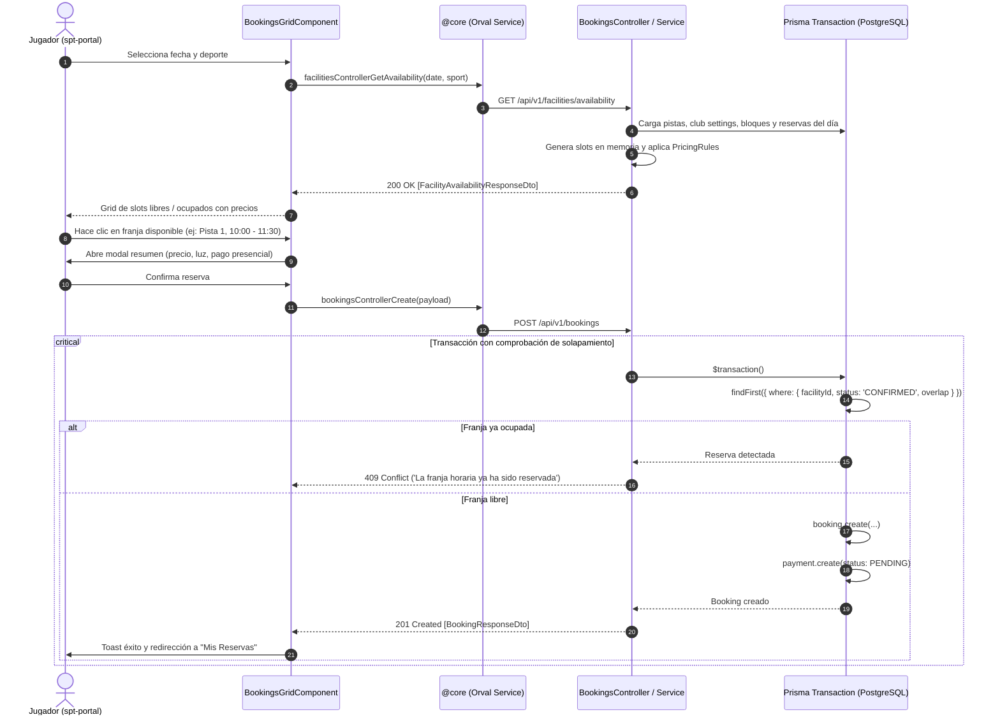

# Diseño Técnico: Motor de Disponibilidad y Reservas (`booking-engine-availability`)

## 1. Contratos OpenAPI y DTOs

### 1.1 Modelos y Respuestas
- **`TimeSlotAvailabilityDto`**:
  ```typescript
  export enum SlotStatus {
    AVAILABLE = 'AVAILABLE',
    OCCUPIED = 'OCCUPIED',
    BLOCKED = 'BLOCKED',
  }

  export class TimeSlotAvailabilityDto {
    startTime: string; // ISO 8601 (ej: "2026-10-20T10:00:00.000Z")
    endTime: string;   // ISO 8601
    startHourText: string; // "10:00"
    endHourText: string;   // "11:30"
    status: SlotStatus;
    price: number;
    isPeakHour: boolean;
    lightSurcharge: number;
    blockedReason?: string | null;
  }

  export class FacilityAvailabilityResponseDto {
    facilityId: string;
    facilityName: string;
    sportType: SportType;
    courtType: CourtType;
    surfaceType: SurfaceType;
    hasLighting: boolean;
    defaultSlotMinutes: number;
    slots: TimeSlotAvailabilityDto[];
  }
  ```

- **`BookingResponseDto`**:
  ```typescript
  export class BookingResponseDto {
    id: string;
    clubId: string;
    facilityId: string;
    userId: string;
    bookingType: BookingType;
    status: BookingStatus;
    startTime: Date;
    endTime: Date;
    totalPrice: number;
    lightIncluded: boolean;
    notes?: string | null;
    createdAt: Date;
    facility: {
      id: string;
      name: string;
      sportType: SportType;
    };
    user?: {
      id: string;
      name: string;
      email: string;
    };
  }
  ```

### 1.2 Peticiones
- **`CreateBookingDto`**:
  ```typescript
  export class CreateBookingDto {
    @IsUUID()
    facilityId: string;

    @IsISO8601()
    startTime: string;

    @IsISO8601()
    endTime: string;

    @IsOptional()
    @IsBoolean()
    lightIncluded?: boolean = false;

    @IsOptional()
    @IsString()
    notes?: string;
  }
  ```

- **`CancelBookingDto`**:
  ```typescript
  export class CancelBookingDto {
    @IsOptional()
    @IsString()
    cancellationReason?: string;
  }
  ```

### 1.3 Endpoints REST
- `GET /api/v1/facilities/availability?date=YYYY-MM-DD&sportType=...`
  - Headers: `x-tenant-id`, `Authorization: Bearer <token>`
  - Retorna: `FacilityAvailabilityResponseDto[]`
- `POST /api/v1/bookings`
  - Headers: `x-tenant-id`, `Authorization: Bearer <token>`
  - Body: `CreateBookingDto`
  - Retorna: `BookingResponseDto` (201 Created)
- `GET /api/v1/bookings/my`
  - Headers: `x-tenant-id`, `Authorization: Bearer <token>`
  - Retorna: `BookingResponseDto[]`
- `DELETE /api/v1/bookings/:id`
  - Headers: `x-tenant-id`, `Authorization: Bearer <token>`
  - Body (opcional): `CancelBookingDto`
  - Retorna: `BookingResponseDto`

---

## 2. Diagrama de Secuencia y Lógica de Concurrencia



---

## 3. Evaluación de Riesgo en Base de Datos

- **Riesgo:** **NULO**.
- **Modelos existentes:**
  - `Booking`, `BookingParticipant` y `Payment` ya están completamente definidos e indexados en `schema.prisma`.
  - Índices existentes: `@@index([clubId, facilityId, startTime, endTime])` y `@@index([clubId, status])`.
- **Integridad:**
  - Toda reserva utiliza `clubId` del tenant activo.
  - La relación con `Facility` tiene regla `onDelete: Restrict` para proteger el historial de reservas de pistas.
  - No se requieren migraciones SQL ni cambios destructivos en tablas de producción.

---

## 4. Diseño de UI / UX en `spt-portal`

- **Rutas en `spt-portal`:**
  - `/portal/book`: Buscador y selector de slots con grid visual por pistas y horas.
  - `/portal/my-bookings`: Vista del jugador con tarjetas de reservas (fecha, pista, importe, estado `CONFIRMADO` y botón para cancelar).
- **Estilos y Componentes:**
  - Uso de tokens del sistema de diseño deportivo (`--spacing-*`, `--surface-card`, `--radius-*`).
  - Botones con directiva `pButton`.
  - Integración centralizada con `NotificationService` y `ConfirmDialogService`.
  - Textos 100% traducidos en `es.json`.
