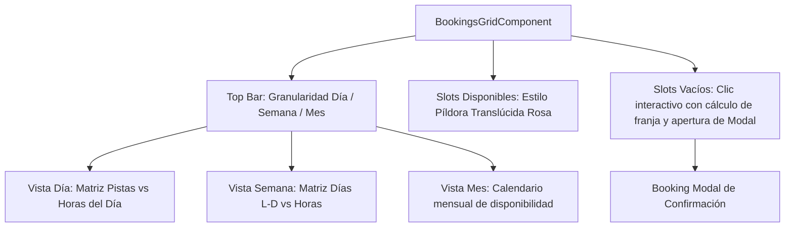

# Diseño Técnico: Granularidad Temporal Día/Semana/Mes, Slots Píldora Neón y Reserva en Vacíos

## Arquitectura de Componentes



## Evaluación de Riesgo en Base de Datos
- **Impacto en BD:** Ninguno (0%). No se alteran modelos de Prisma ni tablas existentes. Utiliza el endpoint existente `facilitiesControllerGetAvailability` y `bookingsControllerCreate`.

## Especificaciones Técnicas

### 1. Granularidad Día / Semana / Mes (`calendarGranularity`)
- Modelo de estado local:
  ```typescript
  type CalendarGranularity = 'day' | 'week' | 'month';
  calendarGranularity: CalendarGranularity = 'day';
  ```
- Opciones de `p-selectbutton`:
  - `day`: 'Día' (`pi pi-calendar`)
  - `week`: 'Semana' (`pi pi-calendar-plus`)
  - `month`: 'Mes' (`pi pi-table`)
- En vista **Semana**:
  - Se calcula el inicio y fin de la semana actual (Lunes a Domingo).
  - Selector de pista rápida para visualizar la semana completa de dicha pista (o pistas destacadas).
  - Botones de navegación semanal: `< Semana anterior`, `Semana actual`, `Semana siguiente >`.
- En vista **Mes**:
  - Calendario de vista mensual con los días del mes y su estado, permitiendo seleccionar cualquier día con un solo clic para ir al detalle.

### 2. Estilo de Slots Píldora Neón (Invertido)
- En `bookings-grid.component.scss`:
  ```scss
  .matrix-slot-button.matrix-slot-available {
    background: rgba(255, 45, 120, 0.12) !important;
    border: 1px solid rgba(255, 45, 120, 0.40) !important;
    color: var(--primary-color) !important;
    border-radius: var(--radius-full) !important;
    transition: all 0.2s cubic-bezier(0.4, 0, 0.2, 1);

    .slot-price-text {
      color: var(--primary-color) !important;
      font-weight: var(--font-weight-bold);
    }

    &:hover {
      background: rgba(255, 45, 120, 0.24) !important;
      border-color: var(--primary-color) !important;
      box-shadow: 0 0 14px rgba(255, 45, 120, 0.35) !important;
      transform: translateY(-2px);
    }
  }

  .matrix-slot-empty {
    cursor: pointer;
    border: 1px dashed var(--border-subtle);
    border-radius: var(--radius-full);
    transition: all 0.2s ease;

    &:hover {
      background: rgba(255, 255, 255, 0.08);
      border-color: var(--primary-color);
      color: var(--primary-color);
    }
  }
  ```

### 3. Lógica de Reserva en Slots Vacíos (`onEmptySlotClick`)
- Parámetros: `facility: FacilityAvailabilityResponseDto`, `timeRange: string`.
- Cálculo de horas:
  - Se extrae la hora de inicio de `timeRange` (ej. "10:00").
  - Duración: `facility.defaultSlotMinutes || 60`.
  - Se calcula `endTime` sumando los minutos a la hora de inicio.
  - Validación de contornos: se comprueba que el fin no solape con el siguiente slot existente de esa pista ni supere las 23:59.
  - Se instancia un `TimeSlotAvailabilityDto` virtual con estado `AVAILABLE` y precio estimado según la tarifa base de la pista.
  - Se invoca `selectSlot(facility, virtualSlot)` para abrir la modal de confirmación.
