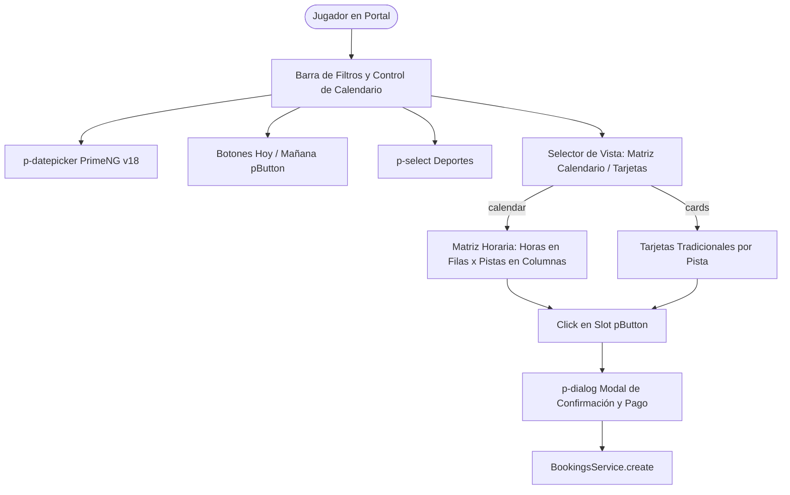

# Design: bookings-calendar-grid-refactor

**Fecha:** 2026-10-22  
**Estado:** 🟡 En Revisión  
**Autor:** Antigravity AI  

---

## 1. Arquitectura de UI y Componentes

### 1.1 Estructura del Cuadrante Horario (Calendario de Pistas)
- A partir de la respuesta de `facilitiesAvailability: FacilityAvailabilityResponseDto[]`, se computan:
  1. `timeHeaders`: Lista ordenada y unificada de todas las franjas horarias existentes en el día (ej: `08:00 - 09:30`, `09:30 - 11:00`, `11:00 - 12:30`, etc.).
  2. Cada pista representa una columna en el encabezado de la tabla.
  3. Cada fila representa una franja horaria.
  4. La celda `(pista, franja)` contiene el `TimeSlotAvailabilityDto` correspondiente, renderizado como botón `pButton` con:
     - `severity="success"` / `primary` si está `AVAILABLE` (mostrando precio formateado con `currency`).
     - Resaltado visual en borde ámbar/dorado si es `isPeakHour` (Hora Punta).
     - Estado deshabilitado sutil si está `OCCUPIED` o `BLOCKED`.

### 1.2 Integración de DatePicker PrimeNG v18
- En `bookings-grid.component.ts`:
  - `selectedCalendarDate: Date = new Date();`
  - Sincronización bidireccional con `selectedDate: string` (`YYYY-MM-DD`) requerido por la API backend.
  - Al cambiar en el datepicker: `onDatePickerChange(newDate: Date)`.
  - Al hacer click en "Hoy" o "Mañana": actualiza tanto `selectedCalendarDate` como `selectedDate` y recarga la disponibilidad.

### 1.3 Cumplimiento Estricto de PrimeNG v18 y [AGENTS.md](file:///Users/jjsanquisb/Labs/spt-app-project/AGENTS.md)
- `ButtonModule` (`pButton`) en TODOS los botones de slots, switches y acciones.
- `DatePickerModule` (`p-datepicker`) en lugar de `<input type="date">`.
- `SelectModule` (`p-select`) con `[fluid]="true"` e `inputId`.
- `DialogModule` (`p-dialog`) y `CheckboxModule` (`p-checkbox`).
- Claves de internacionalización para todos los textos visuales.

---

## 2. Evaluación de Riesgo en Base de Datos

- **Migraciones SQL:** 0 (Ninguna).
- **Modelos Prisma:** 0 (Ninguno modificado).
- **Riesgo:** 🟢 NULO. Es una optimización pura de la interfaz y experiencia de usuario en el frontend del portal.
