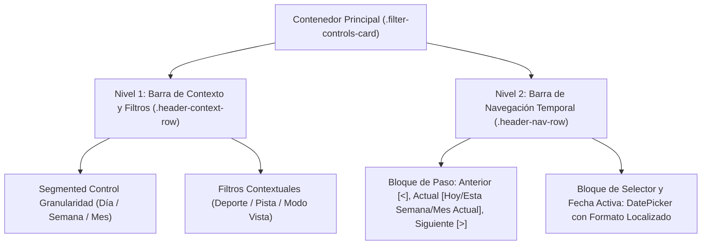

# Diseño Técnico: Rediseño del Layout del Header de Reservas

## 1. Arquitectura de UI y Disposición de Componentes

### Diagrama del Header en 2 Niveles

### Comportamiento por Granularidad

| Nivel / Sección | Vista Día | Vista Semana | Vista Mes |
| :--- | :--- | :--- | :--- |
| **Nivel 1 (Izquierda)** | Granularidad (`Día` activo) | Granularidad (`Semana` activo) | Granularidad (`Mes` activo) |
| **Nivel 1 (Derecha)** | `[🎾 Deporte ▾]` + `[⊞ Cuadrante \| ☰ Pistas]` | `[📍 Pista Activa ▾]` | `[🎾 Deporte ▾]` |
| **Nivel 2 (Paso)** | `[ < ]` `[ Hoy ]` `[ Mañana ]` `[ > ]` | `[ < ]` `[ Esta semana ]` `[ > ]` | `[ < ]` `[ Mes actual ]` `[ > ]` |
| **Nivel 2 (Fecha/Selector)** | `[ 📅 Martes, 27/10/2026 ▾ ]` | `[ 📅 Lun 26/10 — Dom 01/11 ▾ ]` | `[ 📅 Octubre 2026 ▾ ]` |

---

## 2. Tokens del Design System y Espaciados

### Mapeo de Tokens

- **Contenedor `.filter-controls-card`:**
  - `padding: var(--spacing-md)`
  - `background-color: var(--surface-card)`
  - `border: 1px solid var(--border-subtle)`
  - `border-radius: var(--radius-xl)`
  - `gap: var(--spacing-md)`
- **Separador entre Niveles:**
  - `border-top: 1px solid var(--border-subtle)`
  - `padding-top: var(--spacing-sm)`
- **Espaciados internos de filas (`.header-context-row`, `.header-nav-row`):**
  - `gap: var(--spacing-md)`
  - `justify-content: space-between`
  - `align-items: center`
- **Agrupación de Botones de Navegación:**
  - `display: flex; align-items: center; gap: var(--spacing-xs);`
- **Segmented Control (`p-selectbutton`):**
  - Fondo contenedor: `var(--surface-container-low)`
  - Borde: `1px solid var(--border-subtle)`
  - Radio: `var(--radius-lg)`
  - Padding interno: `var(--spacing-2xs)`
  - Botón activo: `background-color: var(--surface-card)`, `color: var(--primary-color)`, `box-shadow: var(--shadow-sm)`
  - Botón inactivo: `background: transparent`, `color: var(--text-muted)`
- **Botones de paso (`pButton`):**
  - Directiva: `<button pButton ...>` con `[rounded]="true"` para flechas circulares e iconos centrados mediante tokens de tamaño.
  - Colores: `severity="secondary"`, `[outlined]="true"`, sin overrides forzados `!important`.

---

## 3. Evaluación de Riesgo en Base de Datos

- **Nivel de Riesgo:** 🟢 **NULO (0/5)**.
- **Justificación:** Los cambios son estrictamente de maquetación, visualización y enlace de eventos de interfaz de usuario en el frontend Angular (`apps/frontend/projects/spt-portal`). No se realizan alteraciones en esquemas de Prisma, consultas SQL, migraciones ni modelos de base de datos.

---

## 4. Accesibilidad y Responsividad

- **Responsividad:** Mediante `@include mobile` y `@include tablet`, los contenedores pasan a apilamiento vertical con `width: 100%`, preservando la ergonomía táctil en pantallas móviles.
- **Accesibilidad:** Todos los botones de flecha incluyen atributos `aria-label` y directivas `[pTooltip]` con claves de traducción.
