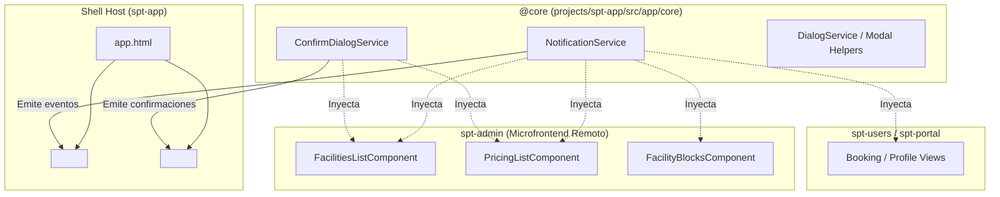

# Design: centralized-ui-services

**Fecha:** 2026-10-20  
**Estado:** 🟡 En Revisión  

---

## 1. Diagrama de Arquitectura



---

## 2. Contratos e Interfaces de Servicio

### A. `NotificationService` (`@core`)
```typescript
export interface NotificationOptions {
  detailKey: string;
  summaryKey?: string;
  params?: Record<string, unknown>;
  life?: number;
}

@Injectable({ providedIn: 'root' })
export class NotificationService {
  success(detailKey: string, summaryKey?: string, params?: Record<string, unknown>): void;
  error(detailKey: string, summaryKey?: string, params?: Record<string, unknown>): void;
  warn(detailKey: string, summaryKey?: string, params?: Record<string, unknown>): void;
  info(detailKey: string, summaryKey?: string, params?: Record<string, unknown>): void;
}
```

### B. `ConfirmDialogService` (`@core`)
```typescript
export interface ConfirmActionOptions {
  headerKey: string;
  messageKey: string;
  messageParams?: Record<string, unknown>;
  icon?: string;
  acceptLabelKey?: string;
  rejectLabelKey?: string;
  severity?: 'primary' | 'danger' | 'warn' | 'secondary';
  onAccept: () => void | Promise<void>;
  onReject?: () => void | Promise<void>;
}

@Injectable({ providedIn: 'root' })
export class ConfirmDialogService {
  confirmDelete(options: {
    messageKey: string;
    messageParams?: Record<string, unknown>;
    onAccept: () => void | Promise<void>;
  }): void;

  confirm(options: ConfirmActionOptions): void;
}
```

---

## 3. Modelos de Datos Afectados

Ninguno. Este cambio es estrictamente a nivel de arquitectura frontend en capa de presentación y servicios de usuario.

---

## 4. Riesgo de Base de Datos y Multi-Tenancy

| Dimensión | Evaluación | Mitigación |
| :--- | :--- | :--- |
| **Riesgo en BBDD** | 🟢 **Nulo (0%)** | No modifica esquemas de Prisma, migraciones SQL, restricciones, índices ni semillas. |
| **Aislamiento Multi-Tenant (`club_id`)** | 🟢 **Preservado** | Los servicios UI consumen los DTOs ya validados y aislados por tenant (`x-tenant-id`). |
| **Pérdida de Información** | 🟢 **Nulo** | No altera llamadas destructivas sin confirmación previa del usuario. |

---

## 5. Diseño UI y Estilos (Athletic Luxury)

1. **`p-confirmdialog`:**
   - Se estiliza en [projects/spt-app/src/styles/components/_dialogs.scss](file:///Users/jjsanquisb/Labs/spt-app-project/apps/frontend/projects/spt-app/src/styles/components/_dialogs.scss).
   - Fondo: `var(--surface-pure)`, borde `var(--border-subtle)`, radio `var(--radius-md)`.
   - Botón Aceptar para borrados: `severity="danger"` con `pButton`.
   - Botón Cancelar: `severity="secondary"` con `[text]="true"`.
2. **`p-toast`:**
   - Ya estilizado en el Shell host. Utiliza tokens de éxito verde turf (`#059669`) y alertas de error `#DC2626`.

---

## 6. Decisiones Técnicas

1. **Servicios `providedIn: 'root'` en `@core`:**  
   Garantiza una única instancia compartida a través de Native Federation entre el Shell (`spt-app`) y los remotos (`spt-admin`, `spt-portal`, `spt-users`), evitando desconexiones de eventos de UI.
2. **Internacionalización Transparente (`ngx-translate`):**  
   Los métodos reciben claves de traducción (ej. `'ADMIN.FACILITIES.DELETE_SUCCESS'`), traduciéndolas de forma síncrona/reactiva antes de emitir a PrimeNG, evitando boilerplate en los componentes.
3. **Migración No Rompiente:**  
   La introducción de estos servicios no rompe la API existente y permite migrar los componentes existentes (`facilities-list`, `pricing-list`, `facility-blocks`) de forma ordenada.
