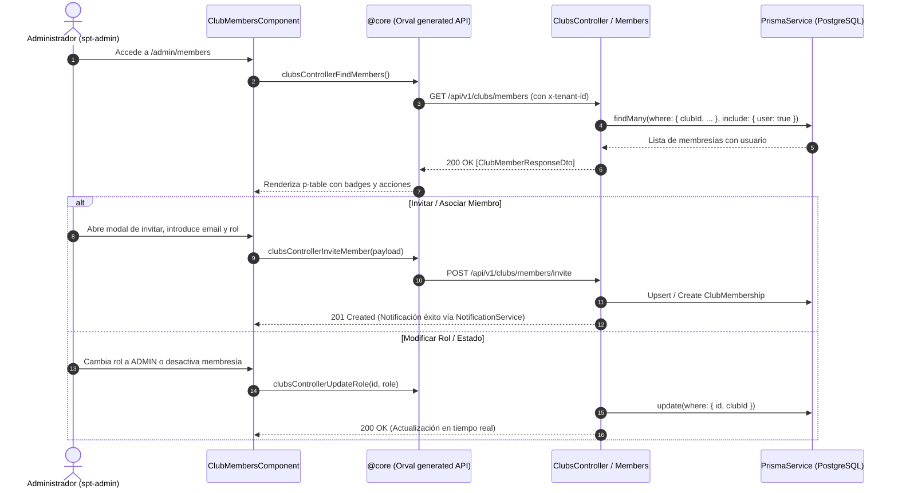

# Diseño Técnico: Gestión de Miembros y Roles del Club (`club-members-management`)

## 1. Contratos OpenAPI y DTOs

### 1.1 Modelos y Respuestas
- **`ClubMemberResponseDto`**:
  ```typescript
  export class ClubMemberResponseDto {
    id: string; // ID de la membresía (ClubMembership.id)
    userId: string;
    clubId: string;
    role: ClubRole; // OWNER | ADMIN | MEMBER | STAFF
    walletBalance: number;
    memberNumber?: string | null;
    isActive: boolean;
    createdAt: Date;
    updatedAt: Date;
    user: {
      id: string;
      email: string;
      name: string;
      phone?: string | null;
      avatarUrl?: string | null;
    };
  }
  ```

### 1.2 Peticiones
- **`InviteMemberDto`**:
  ```typescript
  export class InviteMemberDto {
    @IsEmail()
    email: string;

    @IsEnum(ClubRole)
    role: ClubRole = ClubRole.MEMBER;

    @IsOptional()
    @IsString()
    memberNumber?: string;
  }
  ```

- **`UpdateMemberRoleDto`**:
  ```typescript
  export class UpdateMemberRoleDto {
    @IsEnum(ClubRole)
    role: ClubRole;
  }
  ```

- **`UpdateMemberStatusDto`**:
  ```typescript
  export class UpdateMemberStatusDto {
    @IsBoolean()
    isActive: boolean;
  }
  ```

### 1.3 Endpoints REST
- `GET /api/v1/clubs/members`
  - Headers: `x-tenant-id` (obligatorio), `Authorization: Bearer <token>`
  - Guards: `JwtAuthGuard`, `TenantGuard`, `RolesGuard` (`@Roles('OWNER', 'ADMIN')`)
  - Query: `role?: ClubRole`, `search?: string`, `isActive?: boolean`
  - Retorna: `ClubMemberResponseDto[]`
- `POST /api/v1/clubs/members/invite`
  - Body: `InviteMemberDto`
  - Retorna: `ClubMemberResponseDto`
- `PATCH /api/v1/clubs/members/:id/role`
  - Param: `id` (membershipId)
  - Body: `UpdateMemberRoleDto`
  - Retorna: `ClubMemberResponseDto`
- `PATCH /api/v1/clubs/members/:id/status`
  - Param: `id` (membershipId)
  - Body: `UpdateMemberStatusDto`
  - Retorna: `ClubMemberResponseDto`
- `DELETE /api/v1/clubs/members/:id`
  - Param: `id` (membershipId)
  - Retorna: `{ success: true, message: string }`

---

## 2. Diagrama de Arquitectura y Flujo



---

## 3. Evaluación de Riesgo en Base de Datos (Integridad y Producción)

- **Modelos existentes:**
  - El modelo `ClubMembership` ya existe en `prisma/schema.prisma` con clave foránea obligatoria `clubId`, clave foránea a `User`, e índice único `@@unique([userId, clubId])` e índice de rendimiento `@@index([clubId, role])`.
- **Riesgo de migración:**
  - **NULO**. No se requiere alterar tablas, eliminar columnas ni migrar datos destructivos.
  - La relación multi-tenant ya respeta estrictamente `clubId`.
- **Reglas de integridad de negocio:**
  1. Si un club solo tiene un `OWNER`, no se permite cambiar su rol ni eliminar su membresía.
  2. Al eliminar una membresía, solo se elimina el registro en `club_memberships`, no se borra la cuenta global del `User`.

---

## 4. Diseño de UI / UX en `spt-admin`

- **Ruta:** `/admin/members` (accesible desde el menú lateral/navbar de administración).
- **Componente:** `ClubMembersComponent` standalone.
- **Tokens y Estilos:**
  - Importa `@use "../../../spt-app/src/styles/index" as *;`
  - Utiliza `var(--spacing-*)`, `var(--surface-card)`, `var(--radius-*)` y mixins `@include mobile-or-tablet`.
  - Botones con directiva obligatoria `pButton`.
  - Formularios con clases estándar de diseño `.p-inputtext`, `.p-select`.
  - Modales con layout `.dialog-actions`.
- **Notificaciones y Confirmaciones:**
  - `NotificationService.success('ADMIN.MEMBERS.INVITE_SUCCESS')`
  - `ConfirmDialogService.confirmDelete(...)` para bajas de miembros.
  - Textos 100% en `es.json`.
