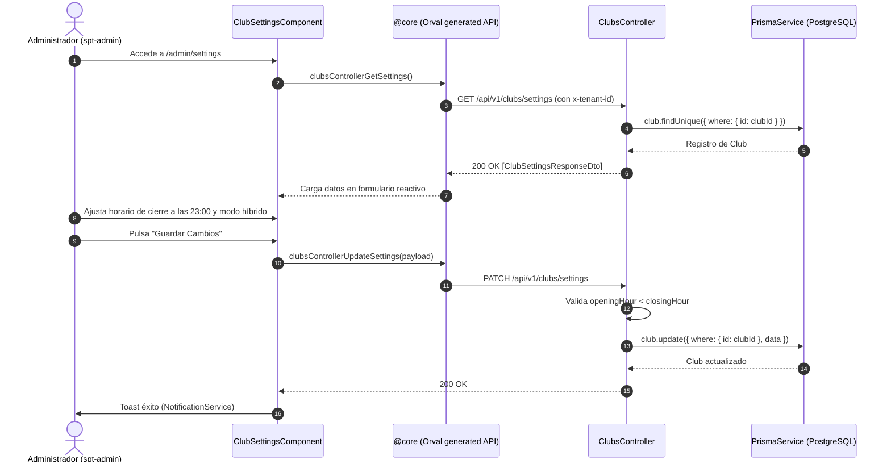

# Diseño Técnico: Configuración y Horarios del Club (`club-settings-schedule`)

## 1. Contratos OpenAPI y DTOs

### 1.1 Modelos y Respuestas
- **`ClubSettingsResponseDto`**:
  ```typescript
  export class ClubSettingsResponseDto {
    id: string;
    name: string;
    slug: string;
    description?: string | null;
    email: string;
    phone?: string | null;
    address?: string | null;
    city?: string | null;
    postalCode?: string | null;
    openingHour: number; // 0 a 23
    closingHour: number; // 1 a 24
    slotDurationMinutes: number; // 30, 60, 90, 120
    openGameMinNoticeHours: number;
    paymentMode: PaymentMode; // PRESENTIAL | ONLINE | HYBRID
    isActive: boolean;
    createdAt: Date;
    updatedAt: Date;
  }
  ```

### 1.2 Peticiones
- **`UpdateClubSettingsDto`**:
  ```typescript
  export class UpdateClubSettingsDto {
    @IsOptional()
    @IsString()
    name?: string;

    @IsOptional()
    @IsString()
    description?: string;

    @IsOptional()
    @IsString()
    phone?: string;

    @IsOptional()
    @IsString()
    address?: string;

    @IsOptional()
    @IsString()
    city?: string;

    @IsOptional()
    @IsString()
    postalCode?: string;

    @IsOptional()
    @IsInt()
    @Min(0)
    @Max(23)
    openingHour?: number;

    @IsOptional()
    @IsInt()
    @Min(1)
    @Max(24)
    closingHour?: number;

    @IsOptional()
    @IsInt()
    @IsIn([30, 60, 90, 120])
    slotDurationMinutes?: number;

    @IsOptional()
    @IsInt()
    @Min(1)
    @Max(72)
    openGameMinNoticeHours?: number;

    @IsOptional()
    @IsEnum(PaymentMode)
    paymentMode?: PaymentMode;
  }
  ```

### 1.3 Endpoints REST
- `GET /api/v1/clubs/settings`
  - Headers: `x-tenant-id` (obligatorio), `Authorization: Bearer <token>`
  - Guards: `JwtAuthGuard`, `TenantGuard`, `RolesGuard` (`@Roles('OWNER', 'ADMIN')`)
  - Retorna: `ClubSettingsResponseDto`
- `PATCH /api/v1/clubs/settings`
  - Headers: `x-tenant-id`, `Authorization: Bearer <token>`
  - Guards: `JwtAuthGuard`, `TenantGuard`, `RolesGuard` (`@Roles('OWNER', 'ADMIN')`)
  - Body: `UpdateClubSettingsDto`
  - Retorna: `ClubSettingsResponseDto`

---

## 2. Diagrama de Arquitectura y Flujo



---

## 3. Evaluación de Riesgo en Base de Datos

- **Riesgo:** **NULO**.
- **Modelos:** El modelo `Club` ya cuenta con todos los campos necesarios (`openingHour`, `closingHour`, `slotDurationMinutes`, `paymentMode`, etc.) definidos en `schema.prisma`. No se alteran esquemas ni se ejecutan migraciones destructivas.

---

## 4. Diseño de UI / UX en `spt-admin`

- **Ruta:** `/admin/settings`.
- **Componente:** `ClubSettingsComponent` standalone.
- **Estructura en Cards:**
  1. *Identidad y Contacto*: Nombre, teléfono, dirección, ciudad, código postal.
  2. *Horarios del Centro*: Selector de apertura (0-23h) y cierre (1-24h), duración de franjas recomendada (60 min).
  3. *Modo de Pago*: Tarjetas o selector para Presencial, Online o Híbrido con explicaciones.
- **Tokens y Estilos:**
  - Importa `@use "base/responsive" as *;`
  - Utiliza `var(--spacing-*)`, `var(--surface-card)`, `var(--border-subtle)`.
  - Formularios estilizados con `.form-group`, `.form-row`, directivas `pInputText`, `pSelect`, `pInputNumber` y `pButton`.
  - Textos y títulos traducidos en `public/assets/i18n/es.json` y `src/assets/i18n/es.json`.
