# Design: club-settings-table-and-profile-cleanup

**Fecha:** 2026-10-28  
**Estado:** 🟡 Borrador  

---

## 1. Diagrama y Arquitectura de Flujo

```mermaid
flowchart TD
    subgraph Profile ["Microfrontend spt-users (/profile)"]
        A[Usuario accede a /profile] --> B[Renderiza Header de Usuario]
        B --> C[Renderiza Formulario 'Datos Personales' centrado]
        C --> D[Guardar Perfil -> UsersService.updateProfile]
    end

    subgraph ClubSettings ["Microfrontend spt-admin (/admin/settings)"]
        E[Admin/Owner accede a /admin/settings] --> F[Carga lista de clubes gestionables]
        F --> G[Renderiza p-table de Clubes]
        G -->|Click acción Configurar| H[Abre p-dialog Modal]
        H --> I[Carga configuración del club seleccionado con x-tenant-id]
        I --> J[Edición de Horarios, Duración y Modo de Pago]
        J -->|Submit| K[ClubsSettingsService.updateSettings con x-tenant-id]
        K --> L[Notificación éxito + Cierre Modal + Refresco Tabla]
    end
```



---

## 2. Contratos de API (OpenAPI)

El evolutivo aprovecha los contratos canónicos ya generados en `@core`:

### Obtener y Actualizar Ajustes de un Club Específico
```yaml
GET /api/v1/clubs/settings:
  summary: Obtener configuración y horarios del club indicado
  headers:
    x-tenant-id: string (requerido)
  responses:
    200:
      schema: ClubSettingsResponseDto

PATCH /api/v1/clubs/settings:
  summary: Actualizar configuración, horarios y modo de pago del club indicado
  headers:
    x-tenant-id: string (requerido)
  requestBody:
    schema: UpdateClubSettingsDto
  responses:
    200:
      schema: ClubSettingsResponseDto
```

### DTOs de Orval consumidos desde `@core`:
- `ClubSettingsResponseDto`:
  - `id`: string
  - `name`: string
  - `slug`: string
  - `email`: string
  - `phone?`: string
  - `description?`: string
  - `address?`: string
  - `city?`: string
  - `postalCode?`: string
  - `openingHour`: number (0-23)
  - `closingHour`: number (1-24)
  - `slotDurationMinutes`: number (30, 60, 90, 120)
  - `openGameMinNoticeHours`: number (1-72)
  - `paymentMode`: `'PRESENTIAL' | 'ONLINE' | 'HYBRID'`
- `UpdateClubSettingsDto`: Campos editables de configuración operativa.

---

## 3. Modelos de Datos Afectados

No hay alteraciones en el esquema de Prisma (`schema.prisma`). Se consultan y actualizan las entidades existentes:
- `Club`
- `ClubMembership`
- `User`

---

## 4. Evaluación de Riesgo de Base de Datos y Multi-tenant

| Riesgo | Nivel | Mitigación |
|---|---|---|
| **Pérdida de datos en producción** | 🟢 Ninguno | No se aplican migraciones, modificaciones de tipos de columnas ni scripts destructivos. |
| **Fuga de datos entre inquilinos (Cross-tenant)** | 🟢 Nulo | `TenantGuard` en NestJS valida que el usuario autenticado posea membresía `OWNER` o `ADMIN` en el `x-tenant-id` proporcionado en la cabecera, o bien que sea `isSuperAdmin`. Peticiones a clubes sin permiso devuelven `403 Forbidden`. |
| **Inconsistencias horarias en el Club** | 🟢 Bajo | Validación estricta tanto en frontend (formulario reactivo + check `openingHour < closingHour`) como en backend DTO con class-validator (`min`, `max`, `isEmail`). |

---

## 5. Diseño de UI (Componentes PrimeNG)

### 5.1 «Mi Perfil» (`profile.component`)
- **Estructura:**
  - Contenedor centrado (`max-width: 680px; margin: 0 auto;`).
  - Tarjeta superior con avatar, nombre, email y tag `SUPERADMIN GLOBAL` (si aplica).
  - Tarjeta de formulario con `pInputText`, `pSize="large"` para Nombre, Apellidos, Teléfono y botón `pButton` "Guardar".
  - Se suprime la tarjeta derecha de membresías.

### 5.2 «Configuración de Clubes» (`club-settings.component`)
- **Cabecera:** `spt-page-header` con icono `pi pi-cog` o `pi pi-building`, título y subtítulo descriptivo.
- **Tabla (`p-table`):**
  - Directivas y propiedades PrimeNG estándar: `[value]="managedClubs"`, `[stripedRows]="true"`, `[paginator]="true"`, `[rows]="10"`.
  - Columnas:
    1. **Centro Deportivo:** Nombre del club con badge de ciudad.
    2. **Rol:** Tag PrimeNG (`OWNER` en rojo/warning, `ADMIN` en info/primary).
    3. **Estado:** Tag `Club Activo` en verde para el club que coincide con `authService.activeClub()?.clubId`.
    4. **Acciones:** `<button type="button" pButton [text]="true" [rounded]="true" iconOnly (click)="openConfigureClub(club)"><i class="pi pi-cog"></i></button>`.
- **Diálogo Modal (`p-dialog`):**
  - `[(visible)]="displayModal" [modal]="true" [dismissableMask]="true" [style]="{ width: '90vw', maxWidth: '720px' }"`.
  - Formulario reactivo de dos columnas con:
    - Nombre, Email, Teléfono, Dirección, Ciudad, Código Postal.
    - Horarios con `p-select`: Hora de apertura (`00:00` a `23:00`) y Hora de cierre (`01:00` a `24:00`).
    - Duración por defecto de pistas (`30`, `60`, `90`, `120` min).
    - Antelación mínima para partidos abiertos (horas).
    - Modo de pago (`PRESENTIAL`, `ONLINE`, `HYBRID`).
  - Botón cancelar y botón guardar con `pButton`.

---

## 6. Decisiones Técnicas

1. **Obtención de clubes gestionables:**
   - Si el usuario es `SuperAdmin`, se pueden listar todos los clubes del sistema a través de `SuperadminClubsService.findAll()` o los clubes de sus membresías.
   - Si el usuario es administrador/owner normal, se listan los clubes filtrados de `authService.currentUser()?.memberships` donde `role === 'OWNER' || role === 'ADMIN'`.
2. **Consumo de Settings por club:**
   - Para no forzar un cambio de inquilino global en la sesión del usuario al editar un club, las peticiones `getSettings` y `updateSettings` se realizan pasando explícitamente la cabecera `x-tenant-id: club.clubId`.
3. **Regla de Monederos:**
   - Se ratifica la directiva de negocio: usuarios con roles `SUPERADMIN`, `OWNER` y `ADMIN` no poseen ni gestionan monedero de socio.
