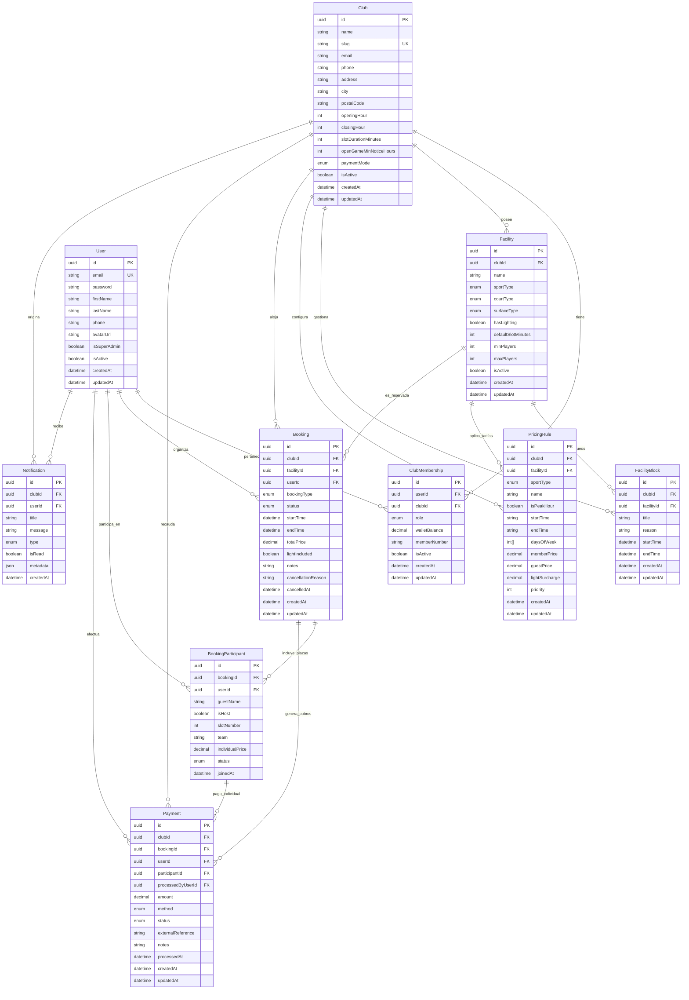

# Design: domain-modeling (Fase 1)

**Fecha:** 2026-10-20  
**Estado:** 🟡 En Revisión  

---

## 1. Diagrama Entidad-Relación (Mermaid)



---

## 2. Estrategia de Multi-Tenancy y Aislamiento de Datos

### Row-Level Multi-Tenancy con `club_id`
Todas las consultas y escrituras que involucren pistas, reservas, cobros o tarifas están estrictamente acotadas por `club_id`:
1. **Validación de Tenant:** En cada petición autenticada, el interceptor o guard de NestJS extrae la cabecera `x-tenant-id`.
2. **Autorización:** Se verifica que el usuario autenticado posea un registro activo en `ClubMembership` para dicho `club_id` con el rol adecuado (`OWNER`, `ADMIN`, `STAFF`, `MEMBER`, `GUEST`).
3. **Filtro automático:** Prisma Service o los repositorios de NestJS inyectan `where: { clubId }` en cada operación de lectura/escritura para evitar fugas entre inquilinos.

---

## 3. Lógica de Negocio y Reglas de Dominio

### A. Cálculo Dinámico de Disponibilidad (TimeSlots al vuelo)
En lugar de persistir millones de slots vacíos en una tabla fija, el motor de backend calcula la disponibilidad en tiempo real para una pista y fecha dadas:
1. Obtiene las horas de apertura (`openingHour`) y cierre (`closingHour`) del club.
2. Genera los intervalos según `defaultSlotMinutes` (ej. 60 o 90 min).
3. Cruza el intervalo con:
   - Reservas activas en `Booking` (`status NOT IN ('CANCELLED')`).
   - Bloqueos de mantenimiento o eventos en `FacilityBlock`.
4. El slot resultante se clasifica como `AVAILABLE`, `OCCUPIED`, `BLOCKED`, o `OPEN_GAME_AVAILABLE` (si es partida abierta con plazas libres).

### B. Partidas Abiertas Universales (Pádel, Tenis, Fútbol 7, Fútbol 11)
Para adaptarse a cualquier deporte sin rigidez:
- Cada `Facility` define su capacidad:
  - Pádel: `minPlayers: 4`, `maxPlayers: 4`.
  - Tenis individual: `minPlayers: 2`, `maxPlayers: 2`.
  - Fútbol 7: `minPlayers: 10`, `maxPlayers: 14`.
  - Fútbol 11: `minPlayers: 14`, `maxPlayers: 22`.
- `BookingParticipant` almacena cada jugador que ocupa una plaza (`slotNumber`), asignando su precio individual (`totalPrice / numPlayers`).
- Si faltan `openGameMinNoticeHours` (ej. 2 horas) antes del inicio:
  - Si `jugadores >= minPlayers`: La partida queda confirmada.
  - Si `jugadores < minPlayers`: Se ejecuta la regla de cancelación automática o aviso al anfitrión, liberando la pista.

### C. Flujo de Pago Local Diferido (En Recepción / Mostrador)
1. **Creación de Reserva:** El usuario reserva en la web/app. Si el club tiene `paymentMode = PRESENTIAL`, la reserva se registra con estado `CONFIRMED` (o `PENDING_CONFIRMATION`) y se crea un registro `Payment` con:
   - `method = PRESENTIAL_CASH` o `PRESENTIAL_POS`
   - `status = PENDING`
2. **Llegada al Centro:** El jugador acude a las instalaciones.
3. **Cobro por Empleado:** El personal de recepción busca la reserva en `spt-admin`, cobra en efectivo o por datáfono y hace clic en "Cobrar".
4. **Cierre de Pago:**
   - `Payment.status` pasa a `COMPLETED`.
   - `Payment.processedByUserId` se establece con el ID del empleado que realizó el cobro.
   - `Payment.processedAt = now()`.
5. **Preparación para Pasarelas Online:** Gracias al desacoplamiento de la entidad `Payment` y el patrón Adapter, añadir Stripe o Redsys en el futuro solo implicará un nuevo valor de `method` y un webhook para marcar el `status` en `COMPLETED`.

---

## 4. Esquema Completo Prisma (`schema.prisma`)

```prisma
datasource db {
  provider = "postgresql"
  url      = env("DATABASE_URL")
}

generator client {
  provider = "prisma-client-js"
}

// =============================================================================
// ENUMS DE DOMINIO
// =============================================================================

enum PaymentMode {
  PRESENTIAL
  ONLINE
  HYBRID
}

enum ClubRole {
  OWNER
  ADMIN
  STAFF
  MEMBER
  GUEST
}

enum SportType {
  PADEL
  TENNIS
  FOOTBALL_7
  FOOTBALL_11
  BASKETBALL
  MULTI_SPORT
}

enum CourtType {
  INDOOR
  OUTDOOR
  COVERED
}

enum SurfaceType {
  CRYSTAL
  CLAY
  SYNTHETIC_GRASS
  CONCRETE
  PARQUET
  RESIN
}

enum BookingType {
  FULL
  OPEN
}

enum BookingStatus {
  PENDING_CONFIRMATION
  CONFIRMED
  CANCELLED
  COMPLETED
  NO_SHOW
}

enum ParticipantStatus {
  REGISTERED
  CONFIRMED
  CANCELLED
  PAID
}

enum PaymentMethod {
  PRESENTIAL_CASH
  PRESENTIAL_POS
  WALLET
  STRIPE
  REDSYS
}

enum PaymentStatus {
  PENDING
  COMPLETED
  REFUNDED
  FAILED
}

enum NotificationType {
  BOOKING_CONFIRMED
  BOOKING_CANCELLED
  OPEN_GAME_JOINED
  OPEN_GAME_COMPLETE
  PAYMENT_RECEIVED
  SYSTEM
}

// =============================================================================
// MODELOS
// =============================================================================

model Club {
  id                     String      @id @default(uuid())
  name                   String      @db.VarChar(150)
  slug                   String      @unique @db.VarChar(100)
  description            String?     @db.Text
  email                  String      @db.VarChar(150)
  phone                  String?     @db.VarChar(50)
  address                String?     @db.VarChar(255)
  city                   String?     @db.VarChar(100)
  postalCode             String?     @map("postal_code") @db.VarChar(20)
  openingHour            Int         @default(8) @map("opening_hour")
  closingHour            Int         @default(23) @map("closing_hour")
  slotDurationMinutes    Int         @default(60) @map("slot_duration_minutes")
  openGameMinNoticeHours Int         @default(2) @map("open_game_min_notice_hours")
  paymentMode            PaymentMode @default(PRESENTIAL) @map("payment_mode")
  isActive               Boolean     @default(true) @map("is_active")
  createdAt              DateTime    @default(now()) @map("created_at")
  updatedAt              DateTime    @updatedAt @map("updated_at")

  memberships   ClubMembership[]
  facilities    Facility[]
  facilityBlocks FacilityBlock[]
  pricingRules  PricingRule[]
  bookings      Booking[]
  payments      Payment[]
  notifications Notification[]

  @@map("clubs")
}

model User {
  id           String   @id @default(uuid())
  email        String   @unique @db.VarChar(150)
  password     String   @db.VarChar(255)
  firstName    String   @map("first_name") @db.VarChar(100)
  lastName     String   @map("last_name") @db.VarChar(100)
  phone        String?  @db.VarChar(50)
  avatarUrl    String?  @map("avatar_url") @db.VarChar(500)
  isSuperAdmin Boolean  @default(false) @map("is_super_admin")
  isActive     Boolean  @default(true) @map("is_active")
  createdAt    DateTime @default(now()) @map("created_at")
  updatedAt    DateTime @updatedAt @map("updated_at")

  memberships       ClubMembership[]
  organizedBookings Booking[]            @relation("BookingsOrganized")
  participations    BookingParticipant[]
  paymentsMade      Payment[]            @relation("PaymentsMade")
  paymentsProcessed Payment[]            @relation("PaymentsProcessed")
  notifications     Notification[]

  @@map("users")
}

model ClubMembership {
  id            String   @id @default(uuid())
  userId        String   @map("user_id")
  clubId        String   @map("club_id")
  role          ClubRole @default(MEMBER)
  walletBalance Decimal  @default(0.00) @map("wallet_balance") @db.Decimal(10, 2)
  memberNumber  String?  @map("member_number") @db.VarChar(50)
  isActive      Boolean  @default(true) @map("is_active")
  createdAt     DateTime @default(now()) @map("created_at")
  updatedAt     DateTime @updatedAt @map("updated_at")

  user User @relation(fields: [userId], references: [id], onDelete: Cascade)
  club Club @relation(fields: [clubId], references: [id], onDelete: Cascade)

  @@unique([userId, clubId])
  @@index([clubId, role])
  @@map("club_memberships")
}

model Facility {
  id                 String      @id @default(uuid())
  clubId             String      @map("club_id")
  name               String      @db.VarChar(100)
  sportType          SportType   @map("sport_type")
  courtType          CourtType   @default(OUTDOOR) @map("court_type")
  surfaceType        SurfaceType @default(SYNTHETIC_GRASS) @map("surface_type")
  hasLighting        Boolean     @default(true) @map("has_lighting")
  defaultSlotMinutes Int         @default(90) @map("default_slot_minutes")
  minPlayers         Int         @default(4) @map("min_players")
  maxPlayers         Int         @default(4) @map("max_players")
  isActive           Boolean     @default(true) @map("is_active")
  createdAt          DateTime    @default(now()) @map("created_at")
  updatedAt          DateTime    @updatedAt @map("updated_at")

  club           Club            @relation(fields: [clubId], references: [id], onDelete: Cascade)
  facilityBlocks FacilityBlock[]
  pricingRules   PricingRule[]
  bookings       Booking[]

  @@index([clubId, sportType])
  @@map("facilities")
}

model FacilityBlock {
  id         String   @id @default(uuid())
  clubId     String   @map("club_id")
  facilityId String   @map("facility_id")
  title      String   @db.VarChar(150)
  reason     String?  @db.Text
  startTime  DateTime @map("start_time")
  endTime    DateTime @map("end_time")
  createdAt  DateTime @default(now()) @map("created_at")
  updatedAt  DateTime @updatedAt @map("updated_at")

  club     Club     @relation(fields: [clubId], references: [id], onDelete: Cascade)
  facility Facility @relation(fields: [facilityId], references: [id], onDelete: Cascade)

  @@index([clubId, facilityId, startTime, endTime])
  @@map("facility_blocks")
}

model PricingRule {
  id             String     @id @default(uuid())
  clubId         String     @map("club_id")
  facilityId     String?    @map("facility_id")
  sportType      SportType? @map("sport_type")
  name           String     @db.VarChar(100)
  isPeakHour     Boolean    @default(false) @map("is_peak_hour")
  startTime      String?    @map("start_time") @db.VarChar(10) // "17:00"
  endTime        String?    @map("end_time") @db.VarChar(10)   // "23:00"
  daysOfWeek     Int[]      @map("days_of_week")              // [1,2,3,4,5] = L a V
  memberPrice    Decimal    @map("member_price") @db.Decimal(10, 2)
  guestPrice     Decimal    @map("guest_price") @db.Decimal(10, 2)
  lightSurcharge Decimal    @default(0.00) @map("light_surcharge") @db.Decimal(10, 2)
  priority       Int        @default(1)
  createdAt      DateTime   @default(now()) @map("created_at")
  updatedAt      DateTime   @updatedAt @map("updated_at")

  club     Club      @relation(fields: [clubId], references: [id], onDelete: Cascade)
  facility Facility? @relation(fields: [facilityId], references: [id], onDelete: SetNull)

  @@index([clubId, facilityId])
  @@map("pricing_rules")
}

model Booking {
  id                 String        @id @default(uuid())
  clubId             String        @map("club_id")
  facilityId         String        @map("facility_id")
  userId             String        @map("user_id")
  bookingType        BookingType   @default(FULL) @map("booking_type")
  status             BookingStatus @default(CONFIRMED)
  startTime          DateTime      @map("start_time")
  endTime            DateTime      @map("end_time")
  totalPrice         Decimal       @map("total_price") @db.Decimal(10, 2)
  lightIncluded      Boolean       @default(false) @map("light_included")
  notes              String?       @db.Text
  cancellationReason String?       @map("cancellation_reason") @db.Text
  cancelledAt        DateTime?     @map("cancelled_at")
  createdAt          DateTime      @default(now()) @map("created_at")
  updatedAt          DateTime      @updatedAt @map("updated_at")

  club         Club                 @relation(fields: [clubId], references: [id], onDelete: Cascade)
  facility     Facility             @relation(fields: [facilityId], references: [id], onDelete: Restrict)
  user         User                 @relation("BookingsOrganized", fields: [userId], references: [id], onDelete: Restrict)
  participants BookingParticipant[]
  payments     Payment[]

  @@index([clubId, facilityId, startTime, endTime])
  @@index([clubId, status])
  @@map("bookings")
}

model BookingParticipant {
  id              String            @id @default(uuid())
  bookingId       String            @map("booking_id")
  userId          String?           @map("user_id")
  guestName       String?           @map("guest_name") @db.VarChar(100)
  isHost          Boolean           @default(false) @map("is_host")
  slotNumber      Int               @map("slot_number")
  team            String?           @db.VarChar(50)
  individualPrice Decimal           @map("individual_price") @db.Decimal(10, 2)
  status          ParticipantStatus @default(REGISTERED)
  joinedAt        DateTime          @default(now()) @map("joined_at")

  booking  Booking   @relation(fields: [bookingId], references: [id], onDelete: Cascade)
  user     User?     @relation(fields: [userId], references: [id], onDelete: SetNull)
  payments Payment[]

  @@unique([bookingId, slotNumber])
  @@index([bookingId, userId])
  @@map("booking_participants")
}

model Payment {
  id                String        @id @default(uuid())
  clubId            String        @map("club_id")
  bookingId         String        @map("booking_id")
  userId            String?       @map("user_id")
  participantId     String?       @map("participant_id")
  processedByUserId String?       @map("processed_by_user_id")
  amount            Decimal       @db.Decimal(10, 2)
  method            PaymentMethod @default(PRESENTIAL_CASH)
  status            PaymentStatus @default(PENDING)
  externalReference String?       @map("external_reference") @db.VarChar(150)
  notes             String?       @db.Text
  processedAt       DateTime?     @map("processed_at")
  createdAt         DateTime      @default(now()) @map("created_at")
  updatedAt         DateTime      @updatedAt @map("updated_at")

  club            Club                @relation(fields: [clubId], references: [id], onDelete: Cascade)
  booking         Booking             @relation(fields: [bookingId], references: [id], onDelete: Cascade)
  user            User?               @relation("PaymentsMade", fields: [userId], references: [id], onDelete: SetNull)
  participant     BookingParticipant? @relation(fields: [participantId], references: [id], onDelete: SetNull)
  processedByUser User?               @relation("PaymentsProcessed", fields: [processedByUserId], references: [id], onDelete: SetNull)

  @@index([clubId, bookingId])
  @@index([clubId, status])
  @@map("payments")
}

model Notification {
  id        String           @id @default(uuid())
  clubId    String?          @map("club_id")
  userId    String           @map("user_id")
  title     String           @db.VarChar(150)
  message   String           @db.Text
  type      NotificationType @default(SYSTEM)
  isRead    Boolean          @default(false) @map("is_read")
  metadata  Json?
  createdAt DateTime         @default(now()) @map("created_at")

  club Club? @relation(fields: [clubId], references: [id], onDelete: Cascade)
  user User  @relation(fields: [userId], references: [id], onDelete: Cascade)

  @@index([userId, isRead])
  @@map("notifications")
}
```

---

## 5. Evaluación de Riesgo de Base de Datos

| Riesgo Identificado | Nivel | Mitigación |
|---------------------|-------|------------|
| **Fuga de datos entre Tenants** | 🔴 Alto | Toda tabla específica incluye `club_id` con índice compuesto y foreign key restrictiva. El guard de autenticación validará `x-tenant-id`. |
| **Colisión de reservas simultáneas (Double Booking)** | 🔴 Alto | Índice compuesto `[clubId, facilityId, startTime, endTime]` en `Booking` y control de transacción atómica en NestJS (`prisma.$transaction`) al crear reservas. |
| **Volumen masivo de franjas horarias** | 🟡 Medio | Resuelto por arquitectura: las franjas horarias se calculan de forma dinámica al vuelo, evitando persistir millones de filas vacías. |
| **Modificación destructiva de esquema** | 🟢 Bajo | Al ser la migración inicial de creación de tablas, no hay riesgo de pérdida de datos preexistentes. |

---

## 6. Decisiones Técnicas

1. **Prisma vs TypeORM:** Se ratifica **Prisma 5** por su type-safety en TypeScript, migraciones declarativas y excelente integración con esquemas relacionales complejos.
2. **Cálculo de Slots Dinámico:** Descartada la tabla física `TimeSlot` pregenerada por su coste de almacenamiento y rigidez frente a cambios de horario del club.
3. **Plazas Universales en Partidas Abiertas:** `minPlayers` y `maxPlayers` configurables por cada pista (`Facility`), permitiendo que el mismo motor atienda partidos de pádel (4), tenis (2 o 4) o fútbol 11 (14 a 22).
4. **Adapter de Pagos Desacoplado:** El modelo `Payment` soporta cobro en efectivo y TPV físico registrando al empleado (`processedByUserId`), manteniendo la estructura lista para añadir Stripe/Redsys sin alterar el esquema relacional.
