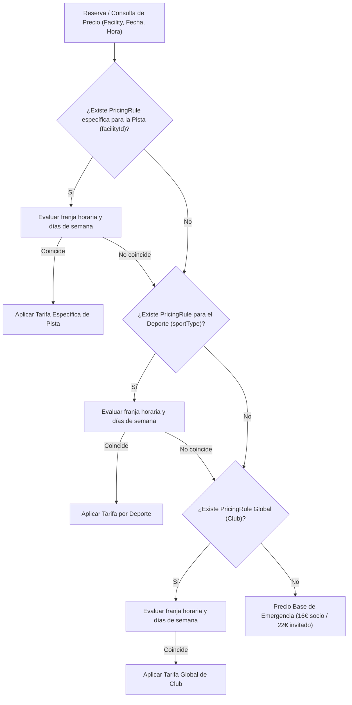

# Diseño Técnico: Jerarquía Inteligente y Gestión Bidireccional de Tarifas

## 1. Arquitectura y Flujo de Resolución de Tarifas



---

## 2. Evaluación de Riesgo en Base de Datos (Regla Crítica)

- **Impacto en Esquema de Base de Datos:** **NULO / SIN RIESGO.**
  - El modelo `PricingRule` en `apps/backend/prisma/schema.prisma` ya cuenta con los campos necesarios:
    ```prisma
    model PricingRule {
      id             String     @id @default(uuid())
      clubId         String     @map("club_id")
      facilityId     String?    @map("facility_id")
      sportType      SportType? @map("sport_type")
      name           String     @db.VarChar(100)
      isPeakHour     Boolean    @default(false) @map("is_peak_hour")
      startTime      String?    @map("start_time") @db.VarChar(10)
      endTime        String?    @map("end_time") @db.VarChar(10)
      daysOfWeek     Int[]      @map("days_of_week")
      memberPrice    Decimal    @map("member_price") @db.Decimal(10, 2)
      guestPrice     Decimal    @map("guest_price") @db.Decimal(10, 2)
      lightSurcharge Decimal    @default(0.00) @map("light_surcharge") @db.Decimal(10, 2)
      priority       Int        @default(1)
      createdAt      DateTime   @default(now()) @map("created_at")
      updatedAt      DateTime   @updatedAt @map("updated_at")

      club     Club      @relation(fields: [clubId], references: [id], onDelete: Cascade)
      facility Facility? @relation(fields: [facilityId], references: [id], onDelete: SetNull)

      @@index([clubId, facilityId])
      @@map("pricing_rules")
    }
    ```
- **Aislamiento Multi-tenant:** Toda consulta (`findMany`, `findFirst`, `create`, `update`, `delete`) incluye `clubId` obligatorio indexado.
- **Peligro de pérdida de datos:** Ninguno. No se ejecutan migraciones destructivas ni eliminaciones de columnas.

---

## 3. Contratos de API y DTOs (Backend)

### 3.1 DTO de Respuesta Enriquecido (`PricingRuleResponseDto`)
Incluye la información de la pista vinculada si existe:
```typescript
export class PricingRuleResponseDto {
  id: string;
  clubId: string;
  facilityId?: string | null;
  facilityName?: string | null; // Nombre desnormalizado/resuelto para UI
  sportType?: SportType | null;
  name: string;
  isPeakHour: boolean;
  startTime?: string | null;
  endTime?: string | null;
  daysOfWeek: number[];
  memberPrice: number;
  guestPrice: number;
  lightSurcharge: number;
  priority: number;
  createdAt: string;
  updatedAt: string;
}
```

### 3.2 Endpoint de Consulta Enriquecida
`PricingService.findAll(clubId, facilityId?)`:
- Hace un `include: { facility: { select: { name: true } } }` para poblar `facilityName`.

---

## 4. Diseño de Componentes de Frontend (`spt-admin`)

### 4.1 Módulo de Tarifas (`pricing-list.component`)
- **Filtros de Lista:** Selector para filtrar tarifas por Ámbito (`Todas`, `Globales`, `Por Deporte`, `Por Pista`).
- **Modal de Creación/Edición:**
  - Selector de Ámbito:
    - `GLOBAL`: Todo el centro deportivo.
    - `SPORT`: Despliega `<p-select>` con los deportes disponibles.
    - `FACILITY`: Despliega `<p-select>` con las pistas activas del club.
  - Tabla de tarifas:
    - Columna **Ámbito / Aplica a**:
      - Si `facilityId`: `<p-tag severity="success" icon="pi pi-map-pin" [value]="rule.facilityName || 'Pista'"></p-tag>`
      - Si `sportType`: `<p-tag severity="info" icon="pi pi-trophy" [value]="'SPORTS.' + rule.sportType | translate"></p-tag>`
      - Si ambos son nulos: `<p-tag severity="secondary" [value]="'ADMIN.PRICING.SCOPE_GLOBAL' | translate"></p-tag>`

### 4.2 Módulo de Pistas (`facilities-list.component`)
- **Columna de Tarifa Base en Tabla:**
  - Muestra el precio base socio/invitado aplicable a la pista.
  - Muestra un tag informativo (*Personalizada*, *Pádel*, *Global*).
- **Modal de Pista (Crear/Editar):**
  - Opción de configuración rápida de tarifa:
    - Selector: *Heredar según deporte/club (automático)* vs *Fijar precio base para esta pista*.
    - Si se elige precio específico: inputs de moneda `p-inputnumber` para Precio Socio y Precio Invitado, que al guardar crean/actualizan la regla de precio vinculada a `facilityId`.
