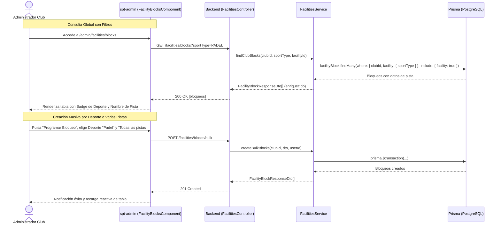

# Diseño Técnico: Gestión Global de Bloqueos por Pista y Deporte

## 1. Arquitectura y Contratos OpenAPI

### 1.1 Nuevos Endpoints y DTOs en Backend (`FacilitiesController`)

#### 1. Listar Bloqueos Globales del Club:
- **Método y Ruta:** `GET /facilities/blocks`
- **Roles permitidos:** `ADMIN`, `OWNER`
- **Query Parameters:**
  - `facilityId?: string` (filtro opcional por instalación concreta)
  - `sportType?: SportType` (filtro opcional por deporte: `PADEL`, `TENNIS`, `PICKLEBALL`, etc.)
- **Respuesta (200 OK):** `FacilityBlockResponseDto[]`

#### 2. DTO Enriquecido: `FacilityBlockResponseDto`
Se extiende el DTO existente con datos de la pista:
```typescript
export class FacilityBlockResponseDto {
  @ApiProperty({ example: 'blk-916b62-92d3-4a9d-86df-87d547e457ea' })
  id: string;

  @ApiProperty({ example: 'ca816b62-92d3-4a9d-86df-87d547e457eb' })
  clubId: string;

  @ApiProperty({ example: 'fac-816b62-92d3-4a9d-86df-87d547e457ec' })
  facilityId: string;

  @ApiPropertyOptional({ example: 'Pista 1 Central' })
  facilityName?: string;

  @ApiPropertyOptional({ enum: SportType, example: SportType.PADEL })
  sportType?: SportType;

  @ApiProperty({ example: 'Mantenimiento focos y red' })
  title: string;

  @ApiPropertyOptional({ type: String, nullable: true, example: 'Revisión técnica' })
  reason?: string | null;

  @ApiProperty({ example: '2026-10-25T10:00:00.000Z' })
  startTime: Date;

  @ApiProperty({ example: '2026-10-25T14:00:00.000Z' })
  endTime: Date;

  @ApiProperty({ example: '2026-10-20T10:00:00.000Z' })
  createdAt: Date;

  @ApiProperty({ example: '2026-10-20T10:00:00.000Z' })
  updatedAt: Date;
}
```

#### 3. Endpoint de Creación en Lote:
- **Método y Ruta:** `POST /facilities/blocks/bulk`
- **Roles permitidos:** `ADMIN`, `OWNER`
- **DTO de Petición:** `BulkCreateFacilityBlockDto`
```typescript
export class BulkCreateFacilityBlockDto {
  @ApiProperty({
    type: [String],
    description: 'Listado de IDs de pistas a bloquear (mínimo 1)',
    example: ['fac-1', 'fac-2'],
  })
  @IsArray()
  @ArrayNotEmpty({ message: 'Debe seleccionar al menos una pista' })
  @IsString({ each: true })
  facilityIds: string[];

  @ApiProperty({
    example: 'Torneo Apertura 2026',
    description: 'Título o concepto del bloqueo',
  })
  @IsString()
  @IsNotEmpty()
  @MinLength(3)
  @MaxLength(150)
  title: string;

  @ApiPropertyOptional({
    example: 'Reserva completa de pistas de pádel para cuadro eliminatorio',
  })
  @IsString()
  @IsOptional()
  reason?: string;

  @ApiProperty({ example: '2026-11-01T08:00:00.000Z' })
  @IsDateString()
  @IsNotEmpty()
  startTime: string;

  @ApiProperty({ example: '2026-11-01T15:00:00.000Z' })
  @IsDateString()
  @IsNotEmpty()
  endTime: string;
}
```
- **Respuesta (201 Created):** `FacilityBlockResponseDto[]`

---

## 2. Diagrama de Secuencia e Interacción



---

## 3. Evaluación de Riesgo en Base de Datos

- **Nivel de Riesgo:** 🟢 **CERO RIESGO DE ROTURA (BAJO)**.
- **Justificación:**
  - El modelo `FacilityBlock` en `schema.prisma` ya cuenta con los campos necesarios (`club_id`, `facility_id`, `title`, `reason`, `start_time`, `end_time`).
  - No se requieren migraciones SQL ni alteraciones en columnas, tipos de datos o restricciones de clave externa.
  - La relación multi-tenant `clubId` se respeta y se valida estrictamente en el servicio:
    ```typescript
    // Verificar que todas las facilityIds pertenecen al clubId del inquilino autenticado
    const count = await this.prisma.facility.count({
      where: { id: { in: facilityIds }, clubId },
    });
    if (count !== facilityIds.length) {
      throw new BadRequestException('Una o más pistas no pertenecen a este club.');
    }
    ```
  - La transacción Prisma (`$transaction`) garantiza atomicidad total: o se crean todos los bloqueos o ninguno, evitando bloqueos huérfanos o parciales.

---

## 4. Diseño de Interfaz de Usuario (UI/UX)

### 4.1 Pantalla Principal (`facility-blocks.component`)
1. **Header unificado (`spt-page-header`):**
   - Título: *"Bloqueos de Instalaciones"*.
   - Subtítulo: *"Gestiona el cierre temporal de pistas por mantenimiento, eventos o climatología"*.
   - Botón *"Volver a Instalaciones"* si se accede desde una pista específica.
   - Filtros en slot `filters`:
     - `p-select` para **Deporte** (Opción "Todos los deportes", "Pádel", "Tenis", etc.).
     - `p-select` para **Pista** (Opción "Todas las pistas" o filtradas por el deporte seleccionado).
   - Botón en slot `actions`:
     - `<button pButton size="large" icon="pi pi-plus" (click)="openCreateModal()">Programar Bloqueo</button>`.

2. **Tabla de Bloqueos (`p-table`):**
   - Columnas:
     1. **Deporte:** `p-tag` con icono y severidad según el deporte (`SportType`).
     2. **Pista:** Nombre de la instalación (`facilityName`).
     3. **Concepto:** Título (`title`).
     4. **Motivo / Detalle:** Texto explicativo o badge de estado.
     5. **Inicio:** Fecha y hora con formato legible.
     6. **Fin:** Fecha y hora con formato legible.
     7. **Acciones:** Botón de eliminar con directiva `pButton` y tooltip.

### 4.2 Modal de Creación (`p-dialog`)
1. **Selector de Deporte:** `p-select` con los deportes disponibles en el club.
2. **Selector de Destino:**
   - Modo *"Una pista específica"* (muestra desplegable de pistas del deporte).
   - Modo *"Todas las pistas del deporte"* (aplica a todas las pistas de ese deporte).
3. **Campos Temporales:**
   - `startTime` y `endTime` (inputs `datetime-local` o calendar).
4. **Campos Descriptivos:**
   - `title` (requerido, min 3, max 150 caracteres).
   - `reason` (opcional).
