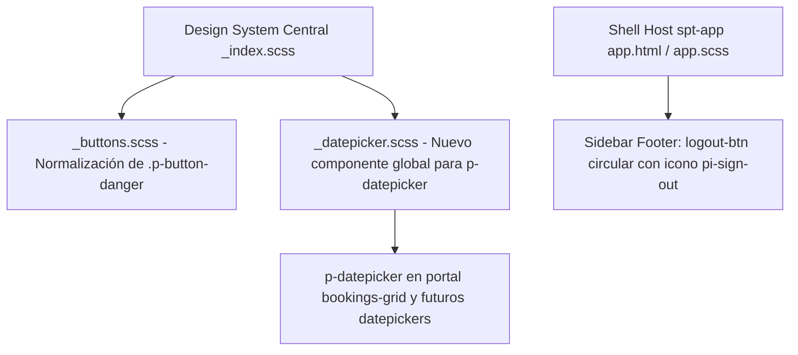

# Diseño Técnico: Corrección de Estilos en Sidebar Logout y DatePicker PrimeNG

## Arquitectura y Componentes Afectados

## Evaluación de Riesgo en Base de Datos
- **Impacto en BD:** Ninguno (0%). Este cambio es estrictamente de diseño y hojas de estilo (CSS/SCSS) en frontend. No altera tablas de Prisma, modelos ni migraciones SQL.

## Decisiones Técnicas y Especificación de Estilos

### 1. Centralización en Design System (`_datepicker.scss`)
Siguiendo la regla de oro de `AGENTS.md`:
- El componente `_datepicker.scss` se ubica en `apps/frontend/projects/spt-app/src/styles/components/_datepicker.scss` y se registra en `_index.scss`.
- No se colocan estilos globales hardcodeados en los componentes de microfrontend.
- Se hace uso estricto de las variables semánticas:
  - Panel contenedor: `background-color: var(--surface-card);`, `border: 1px solid var(--border-subtle);`, `border-radius: var(--radius-md);`, `box-shadow: var(--shadow-tier3);`.
  - Header: `background: transparent;`, `border-bottom: 1px solid var(--border-subtle);`, `color: var(--text-color);`.
  - Botones prev/next: `color: var(--text-muted);`, hover con `background: var(--surface-container-high);`.
  - Días de la semana: `color: var(--text-dim);`, `font-size: var(--font-size-xs);`, `font-weight: var(--font-weight-semibold);`.
  - Días del mes: `color: var(--text-color);`, `border-radius: var(--radius-sm);`, hover con `background: var(--surface-container-high);`.
  - Día seleccionado: `background: var(--primary-gradient);`, `color: #FFFFFF;`, `box-shadow: var(--shadow-glow-pink);`.
  - Día actual: borde `1px dashed var(--primary-color);`.

### 2. Normalización de Botones Danger (`_buttons.scss`)
- Se acota la regla `.btn-danger, .p-button.p-button-danger` agregando el selector `:not(.p-button-text):not(.p-button-outlined)` para evitar que sobrescriba con estilos pesados de botón relleno a botones de tipo texto o redondeados.
- Se proporciona la regla específica `.p-button.p-button-danger.p-button-text` con fondo transparente y hover controlado.

### 3. Sidebar Footer (`app.html` & `app.scss`)
- En `app.html`, asegurar el tag `<i class="pi pi-sign-out"></i>` explícito dentro del botón con directiva `pButton`.
- En `app.scss`, dotar a `.logout-btn` de las mismas dimensiones y disposición que `.theme-toggle-btn`:
  - `width: 2.25rem; height: 2.25rem;`
  - `display: inline-flex; align-items: center; justify-content: center;`
  - `border-radius: var(--radius-full);`
