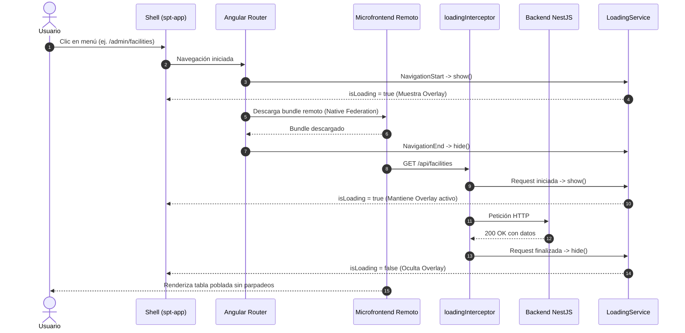

# Diseño Técnico: Spinner Global Centralizado y Limpieza de Spinners en Tablas

## 1. Arquitectura y Flujo de Carga

### 1.1 Diagrama de Secuencia de Carga Unificada


### 1.2 Componentes y Servicios

#### 1.2.1 `LoadingService` (`@core`)
- Ubicación: `apps/frontend/projects/spt-app/src/app/core/services/loading.service.ts`
- Estado con Angular Signals:
  - `activeRequests = signal<number>(0)`
  - `isLoading = computed(() => this.activeRequests() > 0)`
- Métodos públicos:
  - `show(): void`: incrementa `activeRequests`
  - `hide(): void`: decrementa `activeRequests` (asegurando `Math.max(0, val - 1)`)
  - `reset(): void`: restablece a 0 en caso de cancelaciones o errores

#### 1.2.2 `loadingInterceptor` (`@core`)
- Ubicación: `apps/frontend/projects/spt-app/src/app/core/interceptors/loading.interceptor.ts`
- Implementa `HttpInterceptorFn`:
  - Intercepta cada `HttpRequest`.
  - Si la petición tiene cabecera `X-Skip-Loading`, la ignora.
  - De lo contrario, llama a `loadingService.show()` y, en el operador `finalize()`, a `loadingService.hide()`.

#### 1.2.3 Overlay en Shell (`spt-app/app.html` y `app.scss`)
- Se añade dentro de `<main class="app-main">`:
```html
<main class="app-main">
  @if (loadingService.isLoading()) {
    <div class="global-loading-overlay">
      <div class="global-loading-card">
        <p-progress-spinner
          strokeWidth="4"
          ariaLabel="loading"
          class="global-progress-spinner"
        ></p-progress-spinner>
        <span class="global-loading-label">{{ 'COMMON.LOADING' | translate }}</span>
      </div>
    </div>
  }
  <router-outlet></router-outlet>
</main>
```

### 1.3 Limpieza de Tablas Afectadas
Se retira `[loading]="loading"` de:
1. `spt-admin/src/app/pages/facilities/facilities-list.component.html`
2. `spt-admin/src/app/pages/facilities/facility-blocks.component.html`
3. `spt-admin/src/app/pages/pricing/pricing-list.component.html`
4. `spt-admin/src/app/pages/members/club-members.component.html`
5. `spt-admin/src/app/pages/settings/club-settings.component.html`
6. `spt-admin/src/app/pages/activity-logs/activity-logs.component.html`
7. `spt-admin/src/app/pages/superadmin/clubs/superadmin-clubs.component.html`
8. `spt-portal/src/app/pages/activity/user-activity.component.html`

## 2. Evaluación de Riesgo en Base de Datos
- **Impacto en BD:** Ninguno (0%).
- **Archivos:** Solo afecta a la capa de UI de Angular en el frontend.
