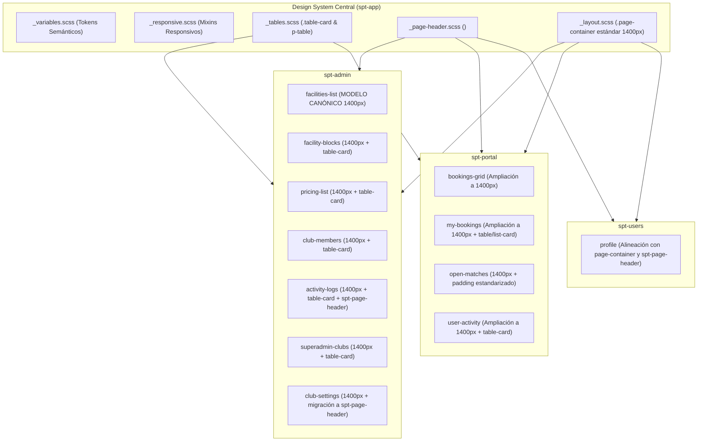

# Diseño Técnico: Unificación Global de Layouts, Cabeceras y Tablas al Modelo de Instalaciones

## 🏛️ Arquitectura de la Solución

Se consolida la directiva de diseño centralizada basada en el modelo de referencia de **Gestión de Pistas e Instalaciones** (`facilities-list`), extendiendo su patrón a todos los módulos y microfrontends:



---

## 📐 Especificación del Modelo Canónico de Layout

### 1. Contenedor de Página Estándar (`.page-container` / `.admin-page-container` / `.portal-page-container`)
Todas las vistas principales adoptan exactamente la métrica de `facilities-list`:
```scss
.page-container,
.admin-page-container,
.portal-page-container,
.superadmin-page-container,
.activity-logs-container {
  max-width: 1400px;
  margin: 0 auto;
  padding: var(--spacing-xl) var(--spacing-lg);
  width: 100%;
  box-sizing: border-box;

  @include mobile {
    padding: var(--spacing-md) var(--spacing-sm);
  }
}
```

### 2. Cabecera Común (`<spt-page-header>`)
Estructura semántica homogénea con proyección de acciones, icono encapsulado en squircle con fondo degradado y sombra glow idéntico al panel de administración (`.header-icon-badge`), y cierre explícito:
```html
<spt-page-header
  [title]="'SECCIÓN.TITLE' | translate"
  [subtitle]="'SECCIÓN.SUBTITLE' | translate"
  icon="pi pi-th-large"
  [backUrl]="optionalBackUrl"
  [backLabel]="optionalBackLabel"
>
  <div actions>
    <button
      type="button"
      pButton
      size="large"
      icon="pi pi-plus"
      (click)="onAction()"
    >
      {{ 'SECCIÓN.ACTION_BTN' | translate }}
    </button>
  </div>
</spt-page-header>
```
- **Icono encapsulado (`.header-icon-badge`):**
  - Contenedor de 52x52px (`width: 52px; height: 52px;`).
  - Radio redondeado `var(--radius-lg)`.
  - Fondo degradado corporativo `background: var(--primary-gradient)`.
  - Sombra glow `box-shadow: var(--shadow-glow-pink)`.
  - Icono blanco centrado con flexbox (`color: #ffffff; font-size: var(--font-size-xl)`).
  - Margen derecho de separación: `margin-right: var(--spacing-2xl)`.
  - Responsive: escala a 44x44px con margen `var(--spacing-md)` en dispositivos móviles.

### 3. Tarjeta de Tabla y Datos (`.table-card` y `p-table`)
Estructura canónica de visualización de datos:
- Encapsulación en `.table-card` ocupando el 100% del ancho del contenedor (1400px).
- Borde sutil `var(--border-subtle)` y sombra `var(--shadow-table)`.
- Paginación estandarizada PrimeNG:
  ```html
  <div class="table-card">
    <p-table
      [value]="items"
      [loading]="loading"
      [stripedRows]="true"
      [paginator]="true"
      [rows]="10"
      [rowsPerPageOptions]="[5, 10, 20, 50]"
      [showCurrentPageReport]="true"
      [currentPageReportTemplate]="'COMMON.PAGE_REPORT' | translate"
    >
      <!-- thead y tbody estandarizados -->
    </p-table>
  </div>
  ```
- Columna de acciones alineada a la derecha con ancho delimitado (`style="width: 8rem"` o `6rem`) y botones PrimeNG con directivas:
  ```html
  <button type="button" pButton iconOnly rounded variant="text" severity="secondary" ...>
    <i class="pi pi-pencil"></i>
  </button>
  ```

### 4. Barras de Filtros y Herramientas (`.filters-toolbar` / `.filters-bar`)
- Tarjeta de superficie con fondo `var(--surface-card)`, borde `var(--border-subtle)`, radio `var(--radius-xl)` y sombra `var(--shadow-card)`.
- Margen inferior estándar: `margin-bottom: var(--spacing-lg)` para mantener el ritmo vertical constante hacia la tabla.

---

## 🔍 Matriz de Componentes y Vistas Afectadas

| Microfrontend | Vista / Componente | Ancho Anterior | Ancho Objetivo | Estado Cabecera (`spt-page-header`) | Estado Tabla (`.table-card`) |
| :--- | :--- | :--- | :--- | :--- | :--- |
| **spt-admin** | `facilities-list` | 1400px | 1400px | ✅ Canónico (Modelo de referencia) | ✅ Canónico |
| **spt-admin** | `facility-blocks` | 1400px | 1400px | ✅ Conectado con backUrl y filtros | ✅ Canónico |
| **spt-admin** | `pricing-list` | 1400px | 1400px | ✅ Conectado con acciones | ✅ Canónico |
| **spt-admin** | `club-members` | 1400px | 1400px | ✅ Conectado con acciones | ✅ Canónico |
| **spt-admin** | `activity-logs` | 1400px | 1400px | ⚠️ Homologar cierre y clase contenedor | ⚠️ Alinear espaciado |
| **spt-admin** | `superadmin-clubs` | 1400px | 1400px | ⚠️ Homologar clase contenedor | ✅ Canónico |
| **spt-admin** | `club-settings` | 1400px | 1400px | ❌ Migrar de header manual a `spt-page-header` | N/A (Formulario en cards) |
| **spt-portal** | `bookings-grid` | 1200px | **1400px** | ✅ Conectado | ✅ Grid calendario ampliado a 1400px |
| **spt-portal** | `my-bookings` | 1200px | **1400px** | ✅ Conectado | ✅ Lista/Tabla ampliada a 1400px |
| **spt-portal** | `open-matches` | 1400px | 1400px | ✅ Conectado | ⚠️ Homologar paddings con facilities |
| **spt-portal** | `user-activity` | 1200px | **1400px** | ✅ Conectado | ✅ Tabla de logs ampliada a 1400px |
| **spt-users** | `profile` | 1000px | 1200-1400px | ⚠️ Estandarizar layout y cabecera | N/A (Perfil) |

---

## 🛡️ Evaluación de Riesgo en Base de Datos

- **Nivel de Riesgo:** **0% (NULO)**.
- **Justificación:** Este cambio corresponde estrictamente a la capa de presentación (HTML, SCSS y componentes de Angular). No se realizan modificaciones en Prisma (`schema.prisma`), entidades, migraciones SQL, APIs backend ni controladores NestJS.
- **Aislamiento Multi-Tenant:** Preservado íntegramente; no se tocan peticiones de red ni cabeceras HTTP.
