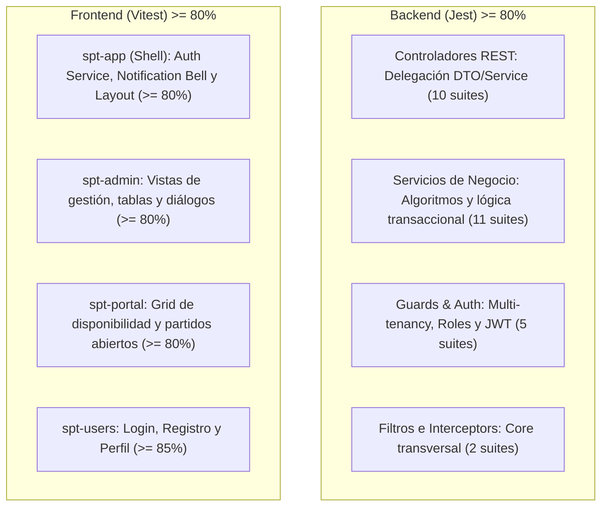

# Design: global-test-coverage-80

**Fecha:** 2026-10-21  
**Estado:** 🟡 En Revisión  
**Autor:** Antigravity + Usuario  

---

## 1. Arquitectura de Testing y Estrategia de Cobertura

Para alcanzar y sostener el objetivo de >= 80% de cobertura global sin inflar innecesariamente el mantenimiento, se estructura la pirámide de tests unitarios:



---

## 2. Ajustes en la Configuración de Cobertura (`apps/backend/package.json`)

En Jest, archivos como `main.ts` (bootstrap de NestFactory) son puramente imperativos para levantar el proceso y no contienen lógica testeable aislada. Se excluye únicamente `main.ts` y archivos de definición pasiva si fuera necesario, manteniendo todos los módulos, controladores, servicios, guards y filtros dentro de `collectCoverageFrom`:

```json
"collectCoverageFrom": [
  "**/*.(t|j)s",
  "!main.ts"
]
```

---

## 3. Desglose de Suites a Implementar en Backend

### Controladores (`apps/backend/src/**/*.controller.spec.ts`)
Cada controlador se testea usando `Test.createTestingModule` con mocks tipados de sus servicios inyectados:
1. `auth.controller.spec.ts`: endpoints `/login`, `/register`, `/refresh`, `/me`.
2. `bookings.controller.spec.ts`: `/bookings`, `/bookings/my`, `/bookings/open-matches`, `/bookings/:id` (cancelación).
3. `clubs.controller.spec.ts`: `/clubs/settings` (GET y PATCH).
4. `clubs-members.controller.spec.ts`: `/clubs/members` (GET, POST invite, PATCH role, PATCH status).
5. `facilities.controller.spec.ts`: `/facilities`, `/facilities/availability`, bloques de pistas.
6. `pricing.controller.spec.ts`: `/pricing/rules` (CRUD de tarifas).
7. `superadmin-clubs.controller.spec.ts`: `/superadmin/clubs` (CRUD de clubes para superadmin).
8. `users.controller.spec.ts`: `/users/me/profile`.
9. `notifications.controller.spec.ts`: `/notifications`, marcar leídas.
10. `health.controller.spec.ts`: `/health`.

### Guards y Seguridad (`apps/backend/src/auth/guards/*.spec.ts`)
1. `tenant.guard.spec.ts`: Valida aislamiento por `x-club-id`, pertenencia a club y bypass de Superadmin.
2. `roles.guard.spec.ts`: Valida lectura de metadata `ROLES_KEY` y permisos del usuario autenticado.
3. `super-admin.guard.spec.ts`: Valida denegación si `is_superadmin === false`.
4. `jwt-auth.guard.spec.ts`: Valida bypass en rutas con `@Public()` decorator.
5. `jwt.strategy.spec.ts`: Valida extracción del payload JWT (`sub`, `email`, `role`, etc.).

### Servicios Faltantes / Aumentar Cobertura (`apps/backend/src/**/*.service.spec.ts`)
1. `users.service.spec.ts`: Obtención y actualización de perfil de usuario.
2. `health.service.spec.ts`: Chequeo de salud de base de datos y memoria.
3. `email-notification.service.spec.ts`: Simulación de envío SMTP con Nodemailer mockeado.
4. `facilities.service.spec.ts`: Completar ramas de actualización y borrado de pistas.
5. `clubs-members.service.spec.ts`: Completar ramas de actualización de rol y estado.
6. `superadmin-clubs.service.spec.ts`: Completar ramas de toggle de estado y borrado.

---

## 4. Desglose de Suites a Implementar en Frontend

### `spt-admin` (de 78.34% a >= 80%)
* [facilities-list.component.spec.ts](file:///Users/jjsanquisb/Labs/spt-app-project/apps/frontend/projects/spt-admin/src/app/pages/facilities/facilities-list.component.spec.ts): Añadir tests para abrir diálogo de creación, guardar pista y confirmar eliminación.
* [club-members.component.spec.ts](file:///Users/jjsanquisb/Labs/spt-app-project/apps/frontend/projects/spt-admin/src/app/pages/members/club-members.component.spec.ts): Añadir tests para invitar miembros, cambiar rol y cambiar estado.
* [pricing-list.component.spec.ts](file:///Users/jjsanquisb/Labs/spt-app-project/apps/frontend/projects/spt-admin/src/app/pages/pricing/pricing-list.component.spec.ts): Añadir tests para formulario reactivo de tarifas.

### `spt-app` (de 75.05% a >= 80%)
* `auth.service.spec.ts` en `@core` / `spt-app`: Cubrir métodos de `login`, `refreshToken`, `logout`, almacenamiento en `localStorage` y reactividad de señales de usuario actual.

---

## 5. Evaluación de Riesgo en Base de Datos (Regla Crítica)

* **¿Hay modificaciones en `prisma/schema.prisma`?:** No.
* **¿Hay migraciones SQL?:** No.
* **¿Hay riesgo de pérdida de datos o inconsistencia?:** 0% (Ningún cambio destructivo, solo adición de suites de prueba unitarias con mocks in-memory).

---

## 6. Verificación y Cierre

1. Ejecución de `cd apps/backend && npm run test:cov` verificando reporte final de líneas >= 80%.
2. Ejecución de `cd apps/frontend && npx ng test spt-admin --watch=false --coverage` (>= 80%).
3. Ejecución de `cd apps/frontend && npx ng test spt-app --watch=false --coverage` (>= 80%).
4. Validación con `npm run test:coverage:diff` y `npm run lint`.
