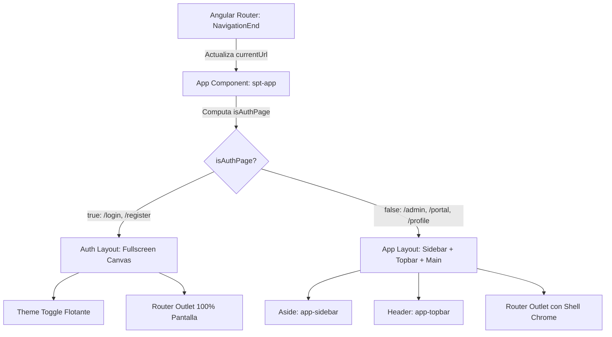

# Design: hide-chrome-auth-pages

**Fecha:** 2026-10-22  
**Estado:** 🟡 En Revisión  
**Autor:** Antigravity AI  

---

## 1. Arquitectura y Componentes Afectados



### 1.1 Señal Reactiva en `App`
- `currentUrl`: `signal<string>(this.router.url)`
- `isAuthPage`: `computed(() => isAuthRoute(this.currentUrl()))`
  Donde las rutas de acceso consideradas son:
  - Exactamente `/login` o prefijos `/login?...`
  - Exactamente `/register` o prefijos `/register?...`

### 1.2 Estructura en `app.html`
```html
<p-toast></p-toast>
<p-confirmdialog></p-confirmdialog>

@if (!isAuthPage()) {
  <!-- Backdrop móvil -->
  <div class="sidebar-backdrop" ...></div>

  <!-- Sidebar Lateral -->
  <aside class="app-sidebar" ...>...</aside>
}

<div class="app-layout" [class.auth-layout]="isAuthPage()" ...>
  <div class="app-main-wrapper">
    @if (!isAuthPage()) {
      <header class="app-topbar">...</header>
    } @else {
      <!-- Botón flotante para alternar tema en pantallas de acceso -->
      <div class="auth-theme-floating">
        <button
          type="button"
          pButton
          [text]="true"
          [rounded]="true"
          size="small"
          (click)="themeService.toggleTheme()"
          [pTooltip]="(themeService.currentTheme() === 'dark' ? 'THEME.TOGGLE_LIGHT' : 'THEME.TOGGLE_DARK') | translate"
          tooltipPosition="left"
          class="theme-toggle-btn"
        >
          <i [class]="themeService.currentTheme() === 'dark' ? 'pi pi-sun' : 'pi pi-moon'"></i>
        </button>
      </div>
    }

    <main class="app-main">
      <router-outlet></router-outlet>
    </main>
  </div>
</div>
```

---

## 2. Evaluación de Riesgo en Base de Datos

- **Migraciones SQL:** 0 (Ninguna).
- **Esquemas Prisma:** 0 (Ninguna modificación en `schema.prisma`).
- **Riesgo:** 🟢 NULO. No se tocan entidades de base de datos ni modelos de persistencia.

---

## 3. Decisiones de Estilos SCSS

- Se definirá en `app.scss`:
  - `.auth-layout`: El layout no aplica flex con sidebar ni desplazamientos.
  - `.auth-theme-floating`: Posicionamiento absoluto/fijo en la esquina superior derecha (`top: var(--spacing-lg); right: var(--spacing-lg); z-index: 1000;`) que permite alternar tema sin romper el centrado del formulario.
  - Mixins responsivos: Se respetan `@include mobile` y variables semánticas oficiales sin valores hardcodeados.
