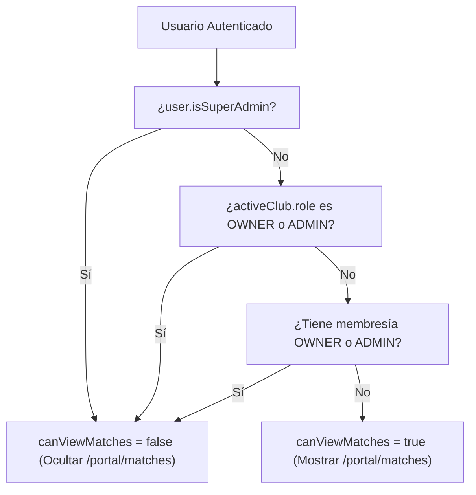
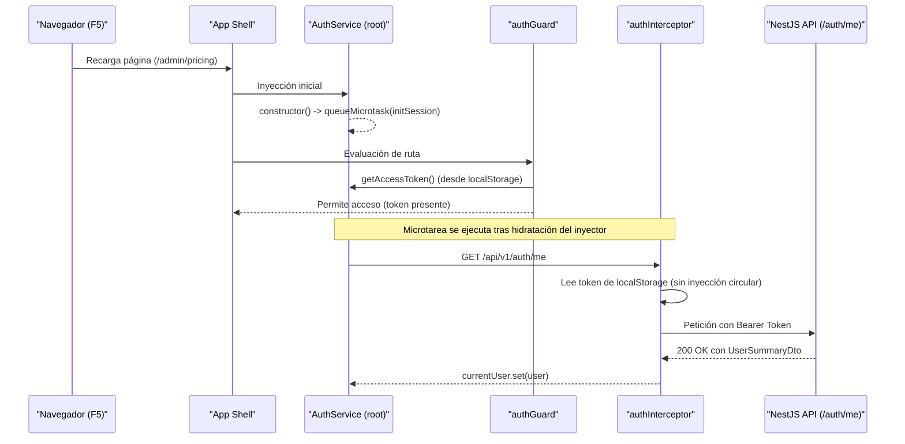

# Diseño Técnico: Mejoras de Shell (Sidebar PrimeNG, Notificaciones y Persistencia)

## 1. Arquitectura de Decisión y Diagramas

### 1.1 Diagrama de Visibilidad de "Mis Partidos"

### 1.2 Diagrama de Flujo de Autenticación y Ciclo de Vida en Recarga (F5)

---

## 2. Especificación Técnica de Componentes

### 2.1 Sidebar Oficial con PrimeNG `p-drawer` (`app.html` & `app.ts`)
- Componente: `DrawerModule` (`p-drawer`) de `primeng/drawer`.
- Configuración:
  - `[(visible)]="sidebarOpen"`
  - `[modal]="!isDesktop()"` (móvil/tablet usa backdrop nativo; escritorio se fija estático)
  - `[dismissible]="!isDesktop()"`
  - `[showCloseIcon]="false"`
  - `position="left"`
  - `styleClass="app-sidebar-drawer"`
- Estilos SCSS:
  - En `@include desktop`: `.app-sidebar-drawer` se fija en el lateral izquierdo con `width: var(--admin-sidebar-w)`, `height: 100vh`, `position: sticky; top: 0;`.
  - En `@include mobile-or-tablet`: `p-drawer` se desliza con animación nativa y máscara PrimeNG sin backdrop manual.

### 2.2 Notificaciones Oficiales PrimeNG (`notification-bell.component`)
- Botón campana encapsulado con `<p-overlaybadge [value]="unreadCount().toString()" severity="danger">` de `OverlayBadgeModule`.
- Desplegable `<p-popover #op styleClass="notification-popover">` de `PopoverModule`.
- Contador en cabecera con `<p-badge [value]="..." severity="danger">`.
- Paleta semántica para iconos según tipo de evento:
  - `BOOKING_CONFIRMED` -> `icon-confirmed` (`--status-confirmed`)
  - `BOOKING_CANCELLED` -> `icon-cancelled` (`--error`)
  - `OPEN_GAME_JOINED` -> `icon-game-joined` (`--cyan-pulse`)
  - `OPEN_GAME_COMPLETE` -> `icon-game-complete` (`--primary`)
  - `PAYMENT_RECEIVED` -> `icon-payment` (`--secondary-fixed`)

### 2.3 Solución de Dependencia Circular `NG0200` (`auth.interceptor.ts` & `auth.service.ts`)
- Inyección de `Injector` de Angular en lugar de `AuthService` directo.
- Headers `Authorization` y `x-tenant-id` resueltos desde `localStorage`.
- Resolución lazy con `injector.get(AuthService)` únicamente dentro del handler de error `401`.
- Ejecución diferida en constructor con `queueMicrotask(() => this.initSession())`.
- Manejo de error en `initSession()` restringido a códigos HTTP 401/403.

---

## 3. Evaluación de Riesgo en Base de Datos

- **Nivel de Riesgo:** 🟢 **NULO (0/5)**.
- **Justificación:** Son modificaciones estrictamente de frontend (layout de componentes PrimeNG, interceptor HTTP y guards reactivos). No se tocan modelos Prisma, migraciones ni datos.

