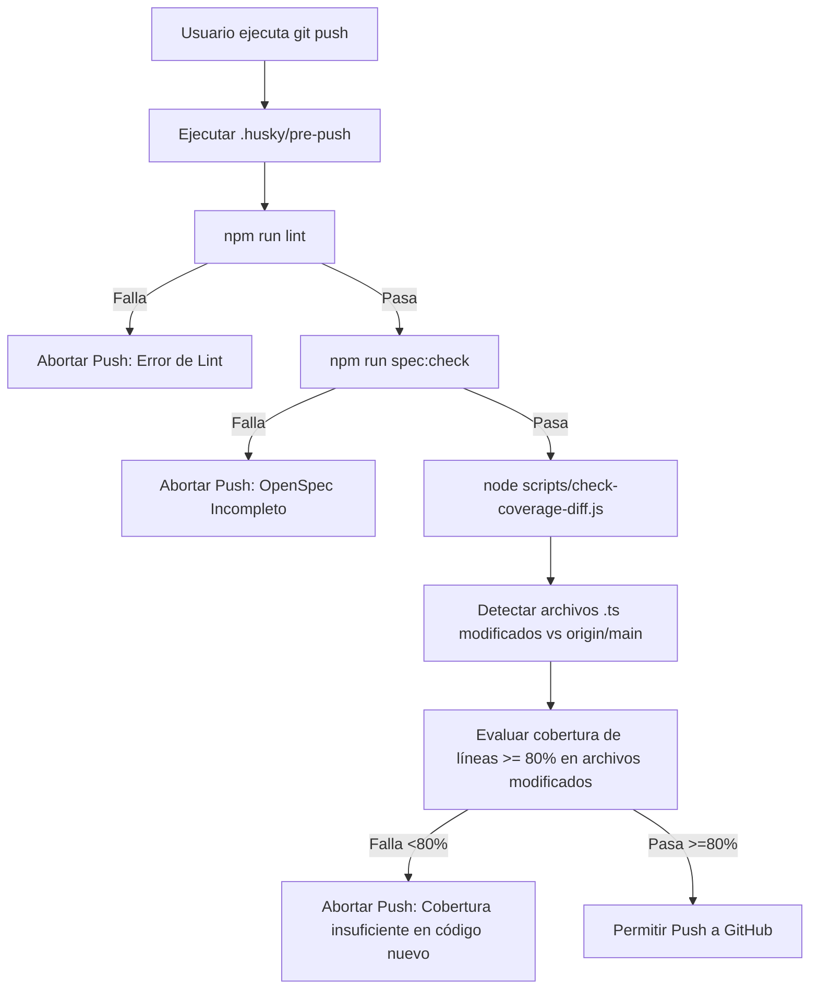

# Diseño Técnico: Hook Pre-Push y Cobertura Diferencial (`husky-pre-push`)

## Flujo del Git Hook

## Arquitectura de `scripts/check-coverage-diff.js`
1. Obtiene los archivos modificados mediante `git diff --name-only origin/main...HEAD` (o contra `HEAD~1` si ya estamos en `main` sin cambios pendientes de upstream).
2. Filtra por archivos de lógica en `apps/backend/src/` terminados en `.ts`, omitiendo:
   - Archivos de pruebas (`*.spec.ts`, `*.e2e-spec.ts`).
   - Módulos de cableado NestJS (`*.module.ts`).
   - DTOs puros (`*.dto.ts`).
   - Archivos de bootstrapping (`main.ts`).
3. Si no hay archivos modificados aplicables (ej. solo cambios de documentación o frontend), aprueba directamente.
4. Si hay archivos modificados, ejecuta Jest con `--coverage --coverageReporters=json-summary`.
5. Lee `apps/backend/coverage/coverage-summary.json` y compara el porcentaje `lines.pct` de cada archivo modificado contra el umbral del 80%.
6. Emite un resumen en tabla: si todos cumplen ≥ 80%, finaliza con código 0. De lo contrario, lista los archivos que incumplen y finaliza con código 1.

## Evaluación de Riesgo en Base de Datos
- **Riesgo:** **0% (Nulo)**.
- **Justificación:** Son herramientas de calidad de desarrollo y hooks locales de Git. No modifican esquemas, datos ni migraciones en PostgreSQL.
