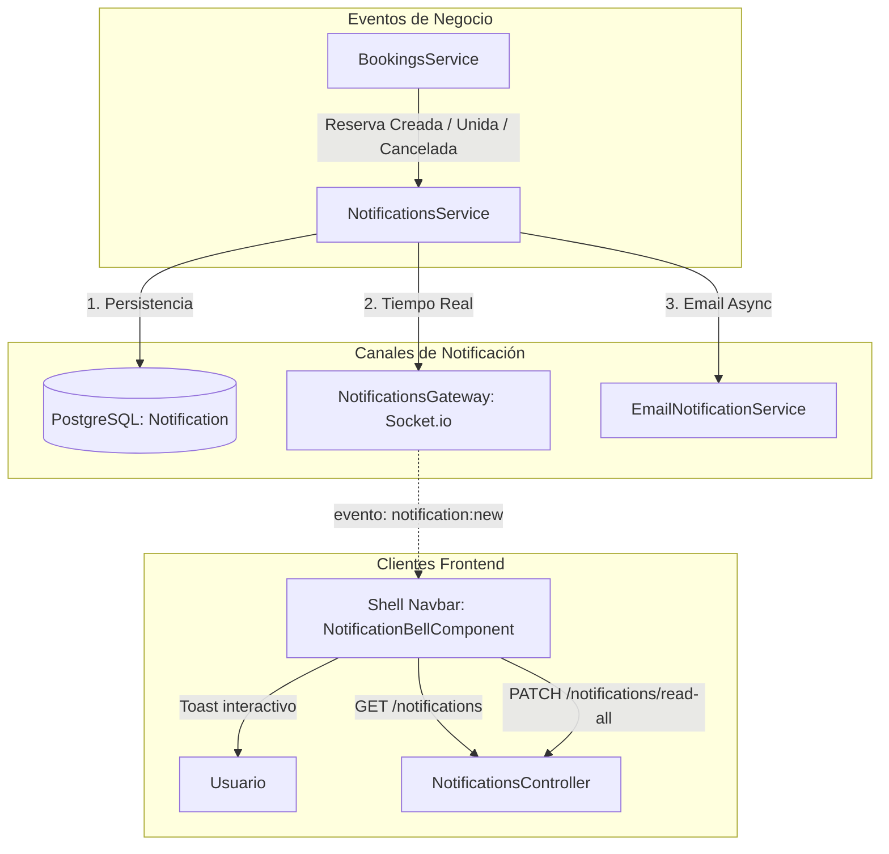

# Diseño Técnico: Notificaciones Multi-canal en Tiempo Real (`multi-channel-notifications`)

## 🛡️ Evaluación Obligatoria de Riesgo en Base de Datos

- **Impacto en Esquema:** Cero cambios DDL en PostgreSQL.
- **Estado Actual:** La tabla `notifications` y el enum `NotificationType` ya existen en `apps/backend/prisma/schema.prisma` desde la Fase 1.
  ```prisma
  model Notification {
    id        String           @id @default(uuid())
    clubId    String?          @map("club_id")
    userId    String           @map("user_id")
    title     String           @db.VarChar(150)
    message   String           @db.Text
    type      NotificationType @default(SYSTEM)
    isRead    Boolean          @default(false) @map("is_read")
    metadata  Json?
    createdAt DateTime         @default(now()) @map("created_at")

    club Club? @relation(fields: [clubId], references: [id], onDelete: Cascade)
    user User  @relation(fields: [userId], references: [id], onDelete: Cascade)

    @@index([userId, isRead])
    @@map("notifications")
  }
  ```
- **Veredicto de Riesgo:** **CERO RIESGO**. No requiere migraciones ni alteraciones estructurales.

---

## 🏗️ Diagrama de Arquitectura y Flujo (Mermaid)



---

## 📋 Contratos OpenAPI y DTOs

### 1. `NotificationResponseDto`
```typescript
export class NotificationResponseDto {
  id: string;
  clubId?: string | null;
  userId: string;
  title: string;
  message: string;
  type: NotificationType;
  isRead: boolean;
  metadata?: Record<string, unknown> | null;
  createdAt: Date;
}

export class NotificationListResponseDto {
  items: NotificationResponseDto[];
  unreadCount: number;
}
```

### 2. Endpoints REST
- `GET /api/v1/notifications` -> `NotificationListResponseDto`
- `PATCH /api/v1/notifications/:id/read` -> `NotificationResponseDto`
- `PATCH /api/v1/notifications/read-all` -> `{ success: boolean; updatedCount: number }`

### 3. WebSocket Gateway (`/notifications`)
- **Namespace:** `/notifications`
- **Autenticación:** Handshake query token o Bearer JWT en `auth.token`.
- **Salas:** Al conectar, el cliente entra en `user:<userId>`.
- **Evento emitido:** `notification:new` con el payload de `NotificationResponseDto`.

---

## 🎨 Diseño de UI (`spt-app` Shell Host)

- **Ubicación:** Navbar superior del Shell (`apps/frontend/projects/spt-app/src/app/layout/navbar.component.html` o cabecera).
- **Elemento visual:** Botón con icono de campana `pi pi-bell` de PrimeNG con directiva `pButton [text]="true"`.
- **Badge:** `pBadge` reactivo con clase `p-badge-danger` mostrando el número de no leídas (oculto si `unreadCount === 0`).
- **OverlayPanel (`p-popover`):**
  - Cabecera con título traducido y botón "Marcar todas como leídas".
  - Lista deslizable con scroll de notificaciones.
  - Indicador de estado leído/no leído con punto de color acento.
  - Formato de fecha relativo mediante pipe (`hace 5 min`, `hace 2 horas`, etc.).
  - Vista vacía con icono cuando no hay notificaciones.
