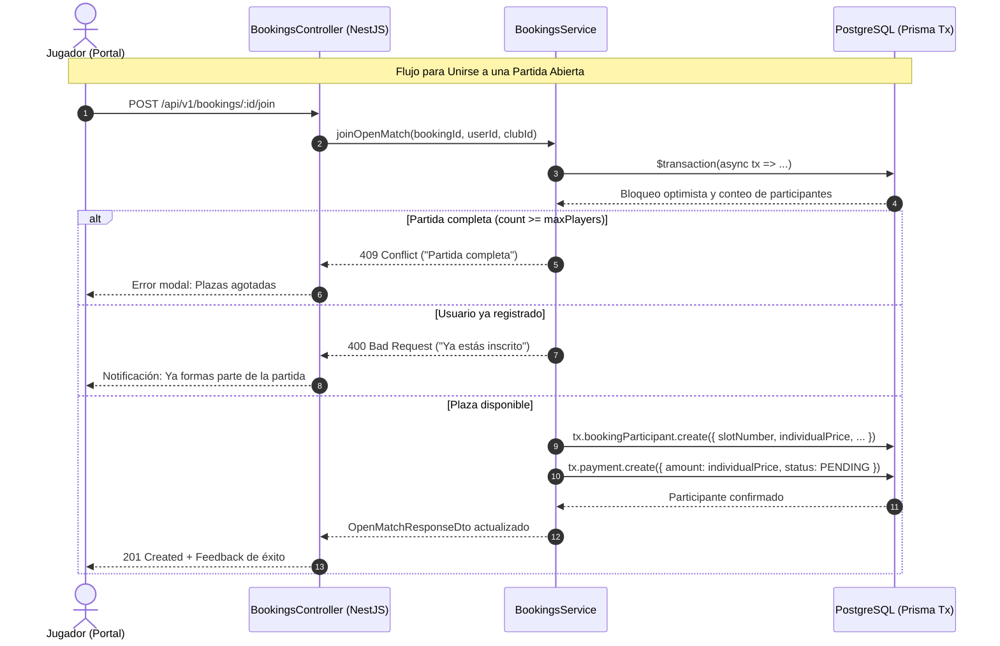

# Diseño Técnico: Partidas Abiertas y Reserva por Plazas (`open-matches`)

## 🛡️ Evaluación de Riesgo en Base de Datos
- **Impacto en Esquema:** Cero cambios destructivos. Las tablas `bookings`, `booking_participants` y el enum `BookingType (FULL, OPEN)` ya existen en `apps/backend/prisma/schema.prisma` y están migrados en PostgreSQL.
- **Aislamiento Multi-Tenant (`club_id`):** Todas las consultas e inserciones validan el `club_id` del usuario autenticado en la sesión/token JWT.
- **Riesgo Global:** Ninguno / Muy bajo. No se requiere ejecutar migraciones DDL (`prisma migrate`).

---

## 🏗️ Diagrama de Flujo (Mermaid)



---

## 📋 Contratos OpenAPI y DTOs

### 1. `OpenMatchResponseDto` (Extensión del detalle de partida)
```typescript
export class OpenMatchParticipantDto {
  id: string;
  userId: string | null;
  name: string;
  avatarUrl?: string | null;
  slotNumber: number;
  isHost: boolean;
  status: 'REGISTERED' | 'PAID' | 'CANCELLED';
  joinedAt: Date;
}

export class OpenMatchResponseDto {
  id: string;
  clubId: string;
  facilityId: string;
  facilityName: string;
  sportType: 'PADEL' | 'TENNIS';
  startTime: Date;
  endTime: Date;
  totalPrice: number;
  pricePerPlayer: number;
  maxPlayers: number;
  availableSlots: number;
  isCurrentUserJoined: boolean;
  isCurrentUserHost: boolean;
  participants: OpenMatchParticipantDto[];
}
```

### 2. Endpoints
- `GET /api/v1/bookings/open?date=YYYY-MM-DD&sportType=PADEL` -> `OpenMatchResponseDto[]`
- `POST /api/v1/bookings/:id/join` -> `OpenMatchResponseDto`
- `DELETE /api/v1/bookings/:id/leave` -> `{ success: boolean }`
- `POST /api/v1/bookings` (Soporte añadido para `bookingType: OPEN`)

---

## 🎨 Diseño de UI (`spt-portal`)

- **Ruta:** `/portal/open-matches` accesible desde la barra de navegación del portal y desde la vista de disponibilidad.
- **Componentes:**
  - `OpenMatchesComponent`: Grid responsivo de tarjetas de partidos.
  - Indicador visual de plazas: Contenedor con `display: flex; gap: var(--spacing-xs);` mostrando fichas con iniciales/avatar de los jugadores y ranuras vacías marcadas con línea punteada `var(--border-subtle)` y texto traducido `"Plaza libre"`.
  - Botón de PrimeNG con directiva `pButton` y variantes semánticas según el estado del usuario (`severity="success"` para unirse, `severity="danger"` para abandonar si ya está dentro).
