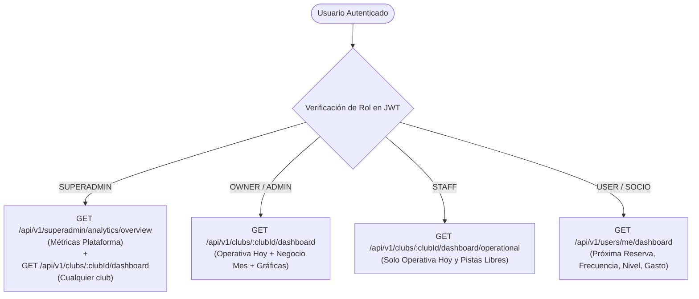

# Diseño Técnico: Jerarquía de Dashboards y KPIs por Rol

## 1. Arquitectura de Endpoints y Seguridad



## 2. Contratos OpenAPI y DTOs

### 2.1 Endpoint Club (Owner / Admin / Superadmin): `GET /api/v1/clubs/:clubId/dashboard`
```typescript
export interface ClubDashboardResponseDto {
  // Bloque 1: Operativa Hoy (Staff + Owner)
  today: {
    totalBookings: number;
    occupancyPercent: number;
    availableCourtsNext3Hours: number;
    pendingPaymentsCount: number;
    activeBlocksCount: number;
  };
  // Bloque 2: Negocio del Mes (Owner)
  month: {
    totalRevenue: number;
    revenueGrowthPercent: number;
    occupancyPercent: number;
    averageTicketPrice: number;
    newMembersCount: number;
  };
  // Bloque 3: Reparto y Tendencias (Gráficas)
  revenueBySport: {
    sportType: string;
    label: string;
    amount: number;
    percent: number;
  }[];
  occupancyTrend: {
    date: string;
    label: string;
    bookingsCount: number;
    occupancyPercent: number;
  }[];
}
```

### 2.2 Endpoint Operativo Staff: `GET /api/v1/clubs/:clubId/dashboard/operational`
* Retorna exclusivamente el objeto `today` de la estructura anterior (sin datos de facturación ni ingresos).

### 2.3 Endpoint Dashboard Jugador: `GET /api/v1/users/me/dashboard`
```typescript
export interface UserDashboardResponseDto {
  nextBooking?: {
    id: string;
    facilityName: string;
    sportType: string;
    startTime: string;
    endTime: string;
  };
  monthlyStats: {
    matchesPlayed: number;
    hoursPlayed: number;
    totalSpent: number;
    estimatedLevel: string; // ej: "3.5 Intermedio"
  };
  activityHistory: {
    month: string;
    matchesCount: number;
  }[];
}
```

### 2.4 Endpoint Superadmin: `GET /api/v1/superadmin/analytics/overview`
```typescript
export interface SuperadminOverviewResponseDto {
  totalClubs: number;
  activeClubs: number;
  totalUsers: number;
  monthlyGmv: number;
  gmvGrowthPercent: number;
}
```

## 3. Estrategia de Implementación en Frontend
- **`spt-admin` (DashboardComponent):**
  - Si el usuario es `STAFF`: Muestra únicamente la fila de tarjetas de **Operativa de Hoy** y estado de pistas.
  - Si el usuario es `OWNER` / `ADMIN`: Muestra la fila de **Operativa de Hoy** + fila de **Rendimiento Financiero del Mes** + **Gráficas `<p-chart>`**.
  - Si el usuario es `SUPERADMIN`: Muestra banner con KPIs globales de plataforma con selector de club para inspeccionar la analítica completa de cualquier club.
- **`spt-portal` (PortalHomeComponent):**
  - Muestra la tarjeta interactiva de **Próxima Reserva** con cuenta atrás, las métricas de actividad del mes y gráfica compacta de frecuencia deportiva.
