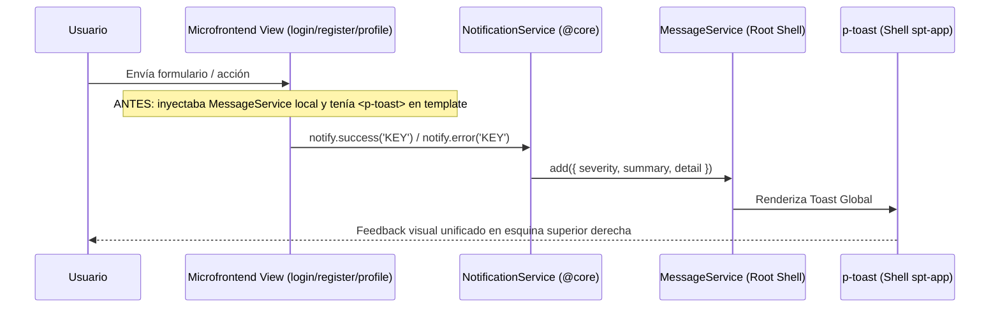

# Design: primeng-components-refactor

**Fecha:** 2026-10-22  
**Estado:** 🟡 Borrador  
**Autor:** Antigravity AI  

---

## 1. Diagrama / Arquitectura

### Flujo de Notificaciones Centralizado (@core)



---

## 2. Contratos de API (OpenAPI)

*No aplica.* Este evolutivo no modifica endpoints ni contratos de API backend.

---

## 3. Modelos de Datos Afectados

*No aplica.* No hay cambios en esquemas de Prisma ni modelos de base de datos.

---

## 4. Riesgo de Base de Datos

| Riesgo | Mitigación |
| :--- | :--- |
| **NULO** | No se altera ninguna entidad, tabla, migración o consulta a la base de datos. |

---

## 5. Diseño UI y Mapeo de Propiedades PrimeNG v18+

### A. Componentes de Tabla (`p-table`)
- **Antes:**
  ```html
  <p-table [value]="data" styleClass="p-datatable-striped">
  ```
- **Después (Canónico v18):**
  ```html
  <p-table [value]="data" [stripedRows]="true">
  ```
  *Motivo:* `styleClass` ya no existe en `p-table` según `@primeng/mcp`, y `[stripedRows]="true"` activa la alternancia de filas nativa sin acoplarse a nombres de clases CSS internas.

### B. Controles de Formulario (`p-select`, `p-inputnumber`, `p-password`)
- **Antes:**
  ```html
  <p-select id="facility-court" [options]="options" styleClass="w-full"></p-select>
  <p-inputnumber id="min" styleClass="w-full" inputStyleClass="w-full"></p-inputnumber>
  ```
- **Después (Canónico v18 & Accesible):**
  ```html
  <label for="facility-court-input">...</label>
  <p-select inputId="facility-court-input" [options]="options" [fluid]="true" [invalid]="isInvalid('courtType')"></p-select>
  
  <label for="min-players-input">...</label>
  <p-inputnumber inputId="min-players-input" [fluid]="true" [invalid]="isInvalid('minPlayers')"></p-inputnumber>
  ```
  *Motivo:* `[fluid]="true"` es la propiedad nativa de PrimeNG v18 para ancho completo, y `inputId` garantiza la asociación semántica con el `<label>` para lectores de pantalla y clics directos.

---

## 6. Decisiones Técnicas

1. **Cumplimiento estricto de [AGENTS.md](file:///Users/jjsanquisb/Labs/spt-app-project/AGENTS.md):**
   - Eliminar el acoplamiento local de `MessageService` y `<p-toast>` en `spt-users`. Al migrar a `NotificationService`, los mensajes se benefician de la traducción automática integrada de claves i18n (`ngx-translate`) y del tema visual centralizado del Shell.
2. **Uso de `[fluid]="true"` frente a `class="w-full"`:**
   - En PrimeNG v18, `[fluid]="true"` aplica internamente la estructura de clases de flexbox y full-width de forma consistente en el wrapper del componente sin requerir reglas CSS manuales adicionales.
3. **Validación visual `[invalid]`:**
   - La directiva `[invalid]` comunica el estado reactivo directamente a PrimeNG, provocando que los bordes y auras de foco utilicen los tokens de tema de error configurados en Stitch / Aura.
