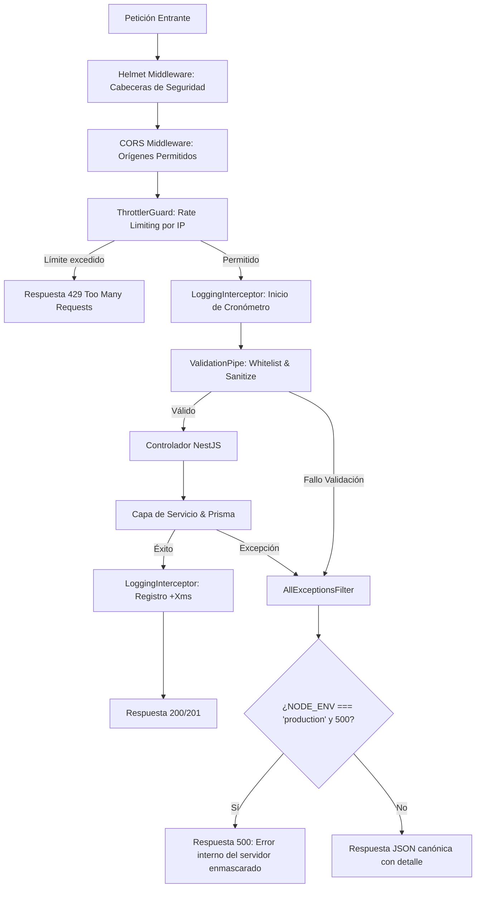

# Diseño de Arquitectura: Hardening y Seguridad (`production-hardening`)

## 1. Evaluación de Riesgo en Base de Datos (Regla Crítica)

> [!NOTE]
> **Evaluación de Riesgo: CERO (0 / 10)**
> Este cambio no modifica el esquema de Prisma (`schema.prisma`), no ejecuta migraciones SQL ni altera restricciones o índices en PostgreSQL. Es un cambio puramente de middleware, guardias y filtros a nivel de capa de aplicación NestJS.

---

## 2. Diagrama de Flujo de Peticiones HTTP



---

## 3. Contratos y Especificación Técnica

### 3.1 Rate Limiting (`@nestjs/throttler`)
- **Configuración Global en `AppModule`**:
  ```typescript
  ThrottlerModule.forRoot([
    {
      name: 'default',
      ttl: 60000,
      limit: 100,
    },
  ])
  ```
- **Endpoints de Autenticación (`AuthController`)**:
  ```typescript
  @Throttle({ default: { limit: 5, ttl: 60000 } })
  @Post('login')
  ...
  @Throttle({ default: { limit: 5, ttl: 60000 } })
  @Post('register')
  ```

### 3.2 Filtro Global de Excepciones Canónico (`AllExceptionsFilter`)
- Ubicación: `apps/backend/src/core/filters/all-exceptions.filter.ts`.
- Mapea tanto `HttpException` estándar como errores desconocidos (incluyendo `PrismaClientKnownRequestError`).
- Formato de respuesta JSON estandarizado:
  ```typescript
  export interface ErrorResponsePayload {
    statusCode: number;
    message: string | string[];
    error: string;
    timestamp: string;
    path: string;
  }
  ```

### 3.3 Interceptor de Logging (`LoggingInterceptor`)
- Ubicación: `apps/backend/src/core/interceptors/logging.interceptor.ts`.
- Formato de log:
  ```
  [HTTP] GET /api/v1/facilities/availability?date=2026-10-21 200 - 32ms
  ```

---

## 4. Registro en el Ciclo de Vida de NestJS

En `main.ts`:
```typescript
app.useGlobalFilters(new AllExceptionsFilter(configService));
app.useGlobalInterceptors(new LoggingInterceptor());
```
En `AppModule`:
```typescript
providers: [
  {
    provide: APP_GUARD,
    useClass: ThrottlerGuard,
  },
]
```
