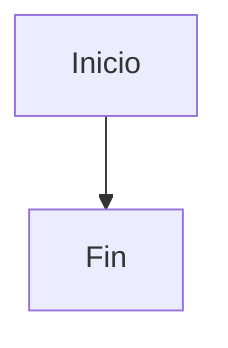

# Design: project-scaffold

**Fecha:** 2026-10-20
**Estado:** 🟡 Borrador

---

## 1. Diagrama / Arquitectura



## 2. Contratos de API (OpenAPI)

> Define los endpoints afectados en formato OpenAPI / pseudo-spec.

```yaml
# Ejemplo:
# POST /api/v1/bookings:
#   summary: Crear reserva
#   requestBody: ...
#   responses: ...
```

## 3. Modelos de Datos Afectados

> Describe los cambios en el schema de Prisma.

```prisma
// Nuevos modelos o modificaciones
```

## 4. Riesgo de Base de Datos

| Riesgo | Mitigación |
|--------|-----------|
| -      | -         |

## 5. Diseño UI (si aplica)

> Describe o incluye wireframes/mockups de las pantallas afectadas.

## 6. Decisiones Técnicas

> Registra aquí las decisiones de diseño tomadas y sus alternativas descartadas.
