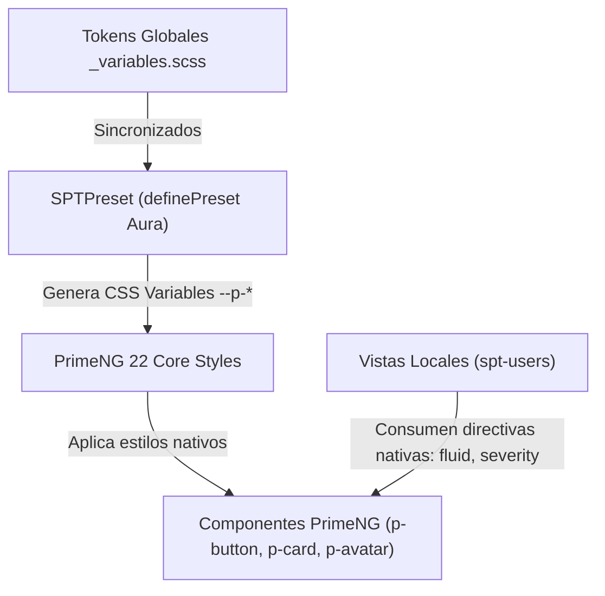

# Diseño Técnico: refactor-primeng-preset-and-clean-overrides

## 1. Arquitectura de Tokens en PrimeNG 22 (@primeng/themes)

PrimeNG 22 implementa una arquitectura basada en `definePreset` que alimenta las variables CSS semánticas (`--p-*`) de los componentes. Para eliminar la necesidad de `!important`, se amplía `SPTPreset` en `apps/frontend/projects/spt-app/src/app/theme/spt.preset.ts` con la sección `components`.

### Diagrama de Flujo de Estilos


## 2. Modificaciones en `SPTPreset` (`spt.preset.ts`)

Se agregan los siguientes componentes en el preset de tema:

```typescript
components: {
  card: {
    root: {
      borderRadius: '{border.radius.xl}',
      shadow: '0 4px 20px -2px rgba(15, 23, 42, 0.06), 0 2px 6px -1px rgba(15, 23, 42, 0.04)',
    },
    body: {
      padding: '1.5rem',
    },
  },
  button: {
    root: {
      borderRadius: '8px',
      label: {
        fontWeight: '600',
      },
    },
  },
  avatar: {
    xl: {
      width: '5rem',
      height: '5rem',
      fontSize: '2rem',
      icon: {
        size: '2rem',
      },
    },
  },
}
```

## 3. Saneamiento de `_buttons.scss`

Se eliminan todas las directivas `!important` en las clases de botón. Las variantes se apoyan en los estilos temáticos de PrimeNG (`p-button-primary`, `p-button-secondary`, `p-button-danger`, `p-button-outlined`) y en variables CSS `--p-button-*`.

## 4. Limpieza de Componentes Locales (`spt-users`)

- **`login.component.html`:** En el botón de envío, se utiliza la directiva oficial de PrimeNG para ancho completo (`[fluid]="true"` o flexbox semántico).
- **`profile.component.html` y `profile.component.scss`:**
  - Se eliminan los selectores `:host ::ng-deep` con `!important`.
  - El avatar utiliza `<p-avatar shape="circle" size="xlarge" ...>` estilizado con clases limpias.
  - Las tarjetas utilizan `<p-card>` alimentadas por los tokens de `SPTPreset`.

## 5. Evaluación de Riesgo en Base de Datos

- **Riesgo en BBDD:** CERO (0). Este cambio afecta única y exclusivamente a la capa visual de frontend, temas de PrimeNG y hojas de estilo SCSS. No modifica Prisma, migraciones ni modelos de base de datos.
