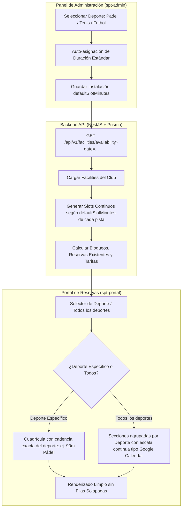

# Diseño Técnico: Estandarización de Duración de Turnos por Deporte y Cuadrícula Continua Tipo Google Calendar

**Fecha:** 2026-10-23
**Estado:** 🟡 Borrador

---

## 1. Diagrama de Arquitectura y Flujo



---

## 2. Contratos de API (OpenAPI)

Los contratos OpenAPI existentes se mantienen 100% compatibles hacia atrás:

### `GET /api/v1/facilities/availability`
- **Query params:** `date: string` (YYYY-MM-DD), `sportType?: SportType`.
- **Response:** `FacilityAvailabilityResponseDto[]`
  ```json
  [
    {
      "facilityId": "uuid",
      "facilityName": "Pista 1 - Pádel Cristal",
      "sportType": "PADEL",
      "defaultSlotMinutes": 90,
      "slots": [
        {
          "startHourText": "08:00",
          "endHourText": "09:30",
          "status": "AVAILABLE",
          "price": 16.0
        }
      ]
    }
  ]
  ```

---

## 3. Modelos de Datos Afectados

El modelo `Facility` en `schema.prisma` ya cuenta con los campos necesarios:
```prisma
model Facility {
  id                 String      @id @default(uuid())
  clubId             String      @map("club_id")
  name               String      @db.VarChar(100)
  sportType          SportType   @map("sport_type")
  defaultSlotMinutes Int         @default(90) @map("default_slot_minutes")
  // ... resto de campos
}
```

### Catálogo Canónico de Duración por Deporte:
| Deporte (`SportType`) | Duración Estándar (`defaultSlotMinutes`) |
| :--- | :--- |
| **PADEL** | **90 min** (1h 30m) |
| **TENNIS** | **60 min** (1h) |
| **FOOTBALL_7 / FOOTBALL_11 / FUTSAL** | **60 min** (1h) |
| **BASKETBALL / VOLLEYBALL / HANDBALL** | **60 min** (1h) |
| **PICKLEBALL / SQUASH / BADMINTON** | **60 min** (1h) |
| **MULTI_SPORT** | **60 min** (1h) |

---

## 4. Evaluación de Riesgo en Base de Datos

| Criterio | Evaluación | Justificación |
| :--- | :--- | :--- |
| **Cambios en Prisma / DDL** | 🟢 **Ninguno** | La columna `default_slot_minutes` ya existe con default 90 y no se altera el esquema. |
| **Aislamiento Multi-Tenant (`club_id`)** | 🟢 **Intacto** | Todas las consultas y operaciones continúan filtrando estrictamente por `clubId`. |
| **Riesgo de Pérdida de Datos** | 🟢 **Nulo** | No se eliminan ni modifican registros existentes en base de datos. Solo se alinea el seed para consistencia. |
| **Compatibilidad con Producción** | 🟢 **100% Compatible** | No requiere scripts de migración destructivos. |

---

## 5. Diseño de UI y Experiencia de Usuario (UX)

### 5.1 En `spt-admin` (Formulario de Pistas)
- Al cambiar el dropdown `sportType`, se actualiza automáticamente el valor de `defaultSlotMinutes`:
  - Si selecciona `PADEL` -> `90 minutos`.
  - Si selecciona `TENNIS` o `FOOTBALL_*` -> `60 minutos`.
- El campo `defaultSlotMinutes` permanece visible para verificación o personalización por parte del administrador si una pista específica lo requiere.

### 5.2 En `spt-portal` (`bookings-grid`)
- **Modo "Deporte Específico" (ej. Pádel o Tenis):**
  - Todas las pistas tienen exactamente la misma duración (ej: 90 min en Pádel).
  - La columna de horas muestra la progresión natural (`08:00 - 09:30`, `09:30 - 11:00`, `11:00 - 12:30`...).
- **Modo "Todos los deportes":**
  - Para evitar mezclar turnos de 90 min y 60 min en filas arbitrarias que crean huecos artificiales, la cuadrícula agrupa las pistas por deporte en bloques con su escala temporal limpia (o secciones por deporte), garantizando una experiencia visual idéntica a Google Calendar donde cada deporte tiene su cuadrante alineado y legible.

---

## 6. Decisiones Técnicas

1. **Duración única por deporte (aprobado por usuario):** Se descarta permitir múltiples duraciones concurrentes en un mismo deporte (como mezclar turnos de 60 min y 90 min en la misma pista) para evitar la fragmentación de horas muertas (ej. huecos de 30 minutos inútiles).
2. **Reutilización de Tokens del Design System:** Todos los estilos respetan las directivas de `AGENTS.md` consumiendo tokens semánticos `var(--spacing-*)`, `var(--radius-*)` y mixins responsivos `@include mobile`.
