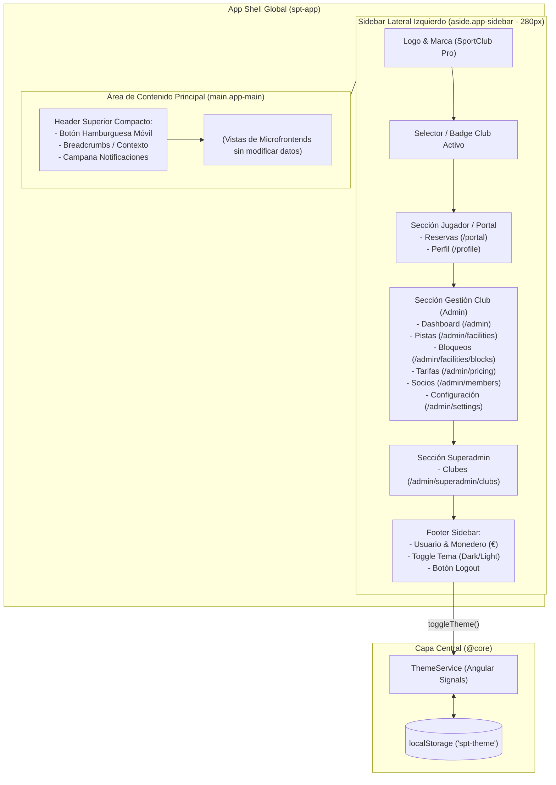

# Design: stitch-design-system-theme-toggle

**Fecha:** 2026-10-22  
**Estado:** 🟡 Borrador (A la espera de aprobación de usuario)  
**Proyecto Stitch:** [Sports Club Management Design System (8260991373480520012)](https://stitch.withgoogle.com/projects/8260991373480520012)

---

## 1. Arquitectura del Layout: Sidebar Lateral Izquierdo + Contenido Principal

Siguiendo las especificaciones de las pantallas de Stitch, la plataforma adoptará la estructura de **App Shell con Sidebar lateral izquierdo (`aside.app-sidebar`) y Contenido Principal a la derecha (`main.app-main`)**:



### 1.1. Comportamiento Responsivo del Layout
- **Escritorio (`> 1024px` con `@include desktop`):**
  - El sidebar izquierdo permanece anclado y visible de forma fija (`width: var(--admin-sidebar-w, 280px)`).
  - El área de contenido principal se sitúa a la derecha con scroll vertical independiente (`overflow-y: auto`) y fondo `--bg-canvas`.
- **Móvil y Tablet (`<= 1024px` con `@include mobile-or-tablet`):**
  - El sidebar se convierte en un menú lateral plegable (*off-canvas drawer* con backdrop oscurecido).
  - Un botón hamburguesa en la barra superior compacta permite abrir/cerrar el sidebar con animación fluida.

---

## 2. Contratos de API (OpenAPI)

*No aplica.* Este evolutivo es puramente de presentación, layout y diseño de interfaz en la capa Frontend. No se añaden, eliminan ni modifican endpoints HTTP del backend.

---

## 3. Modelos de Datos Afectados

*No aplica.* No se modifica el esquema de base de datos (`schema.prisma`) ni existen migraciones SQL involucradas.

---

## 4. Evaluación de Riesgo de Base de Datos e Integridad Multi-Tenant

| Análisis de Riesgo | Evaluación | Mitigación / Justificación |
| :--- | :--- | :--- |
| **Pérdida o corrupción de datos** | 🟢 **NULO** | El cambio no interactúa con Prisma, Postgres ni endpoints de base de datos. |
| **Aislamiento Multi-Tenant (`club_id`)** | 🟢 **NULO** | No se tocan repositorios, servicios ni entidades multi-inquilino. El selector y badge de club activo se alojan en el sidebar sin alterar su lógica. |
| **Ruptura de contratos de DTOs** | 🟢 **NULO** | Los tipos e interfaces de `@core` generados por Orval permanecen intactos. |

---

## 5. Mapeo Exhaustivo de Tokens del Sistema de Diseño Stitch

A continuación se define la especificación de tokens para `_variables.scss`, extrayendo las definiciones del proyecto Stitch `8260991373480520012`:

### 5.1. Colores y Superficies

| Token Semántico | Modo Oscuro (Stitch Principal) | Modo Claro (Stitch Light) | Uso en UI |
| :--- | :--- | :--- | :--- |
| `--bg-canvas` | `#111126` (surface-dim) | `#F8FAFC` (slate-50) | Fondo principal del área de contenido |
| `--surface-pure` | `#111126` | `#FFFFFF` | Superficie base limpia |
| `--surface-sidebar` | `#0C0C21` / `#111126` | `#FFFFFF` / `#F8FAFC` | Fondo del sidebar lateral izquierdo |
| `--surface-card` | `#1D1D33` (surface-container) | `#FFFFFF` | Fondo de tarjetas, tablas y modales |
| `--surface-container-lowest` | `#0C0C21` | `#FFFFFF` | Fondos de inputs o subtareas |
| `--surface-container-low` | `#19192F` | `#F8FAFC` | Franjas alternadas, listas secundarias |
| `--surface-container` | `#1D1D33` | `#FFFFFF` | Paneles estándar |
| `--surface-container-high` | `#28283E` | `#F1F5F9` | Hover de filas, cabeceras de tablas |
| `--surface-container-highest` | `#333349` | `#E2E8F0` | Bordes activos, barras de herramientas |
| `--border-subtle` | `rgba(171, 136, 142, 0.20)` / `#28283E` | `#E2E8F0` | Divisores y bordes sutiles |
| `--border-input` | `#333349` | `#CBD5E1` | Bordes de inputs en reposo |
| `--primary` / `--primary-color` | `#FF2D78` (Neon Pink / Magenta) | `#FF2D78` (Neon Pink Accent) | Botón de acción principal, call-to-actions |
| `--primary-gradient` | `linear-gradient(135deg, #FF2D78 0%, #FF4C83 100%)` | `linear-gradient(135deg, #FF2D78 0%, #E11D48 100%)` | Gradiente hero y botones destacados |
| `--primary-glow` | `rgba(255, 45, 120, 0.35)` | `rgba(255, 45, 120, 0.20)` | Sombra exterior o resplandor de acento |
| `--secondary` | `#FFFFFF` | `#0F172A` | Color de contraste secundario |
| `--secondary-fixed` / `--neon-cyan` | `#24FFCD` (Cyan / Mint) | `#059669` (Esmeralda oscuro) | Estados activos, iluminación LED, éxito |
| `--tertiary` / `--neon-yellow` | `#E3C630` / `#FFE04A` | `#D97706` | Advertencias, pistas en mantenimiento |
| `--error` / `--neon-error` | `#FFB4AB` / `#FF4D4D` | `#DC2626` | Errores, acciones destructivas |
| `--text-color` / `--on-surface` | `#E2E0FD` | `#0F172A` | Texto de lectura principal |
| `--text-muted` / `--on-surface-variant` | `#E4BDC3` / `#A5A3C8` | `#64748B` | Texto secundario y enlaces inactivos |
| `--text-dim` | `#8280A8` | `#94A3B8` | Subtítulos tenues, placeholders |
| `--admin-sidebar-w` | `280px` | `280px` | Ancho del sidebar lateral en escritorio |

### 5.2. Jerarquía Tipográfica

De acuerdo con el proyecto Stitch, se configuran tres fuentes complementarias:
1. **Headline Font:** `Sora` (700 / 600) — Títulos de sección, cabeceras de página y cifras KPI destacadas.
2. **Body Font:** `Inter` (400 / 500) — Celdas de tabla, formularios, párrafos informativos.
3. **Label / UI Font:** `Space Grotesk` (500 / 700) — Enlaces del sidebar, badges, etiquetas de estado, nombres de columnas y botones.

Se cargarán en `index.html` mediante Google Fonts:
```html
<link rel="preconnect" href="https://fonts.googleapis.com">
<link rel="preconnect" href="https://fonts.gstatic.com" crossorigin>
<link href="https://fonts.googleapis.com/css2?family=Inter:wght@400;500;600;700&family=Sora:wght@600;700;800&family=Space+Grotesk:wght@500;600;700&display=swap" rel="stylesheet">
```

### 5.3. Elevación y Sombras (Depth & Glow)

- **Modo Oscuro:**
  - `--shadow-sidebar`: `4px 0 24px rgba(0, 0, 0, 0.45)`
  - `--shadow-card`: `0 8px 32px 0 rgba(0, 0, 0, 0.40)`
  - `--shadow-glow-pink`: `0 0 20px rgba(255, 45, 120, 0.35)`
  - `--shadow-glow-cyan`: `0 0 16px rgba(36, 255, 205, 0.30)`
- **Modo Claro:**
  - `--shadow-sidebar`: `2px 0 12px rgba(15, 23, 42, 0.05)`
  - `--shadow-card`: `0 4px 20px -2px rgba(15, 23, 42, 0.06), 0 2px 6px -1px rgba(15, 23, 42, 0.03)`
  - `--shadow-tier1`: `0 1px 3px 0 rgba(0, 0, 0, 0.05)`

---

## 6. Diseño UI y Adaptación de Componentes

### 6.1. Sidebar de Navegación Lateral (`spt-app/src/app/app.html`)
- **Estructura semántica (`<aside class="app-sidebar">`):**
  - **Cabecera:** Logo con resplandor, título de la aplicación y selector de club activo.
  - **Grupos de navegación:** Enlaces con iconos `pi` y tipografía `Space Grotesk`, resaltando el elemento activo con fondo `--primary-gradient` o `--surface-container-high` y texto de alto contraste.
  - **Pie del Sidebar:** Widget de usuario autenticado con avatar/nombre, saldo de monedero (€), botón selector de tema (`ThemeService.toggleTheme()`) y botón de cerrar sesión.

### 6.2. Header Superior Compacto (`<header class="app-topbar">`)
- Botón hamburguesa para dispositivos móviles (`@include mobile-or-tablet`).
- Migas de pan / título de contexto.
- Campana de notificaciones (`<app-notification-bell>`).

### 6.3. Tablas PrimeNG (`_tables.scss` y vistas de microfrontends)
- Respeto a las directivas `#header`, `#body`, `#emptymessage` de `p-table`.
- Cabecera con fondo `--surface-container-high` y texto en `--text-dim` con tipografía `Space Grotesk`.
- Filas alternadas suaves con `--surface-container-low` y hover interactivo con `--surface-container-high`.
- Las columnas actuales se mantienen 100% intactas.

### 6.4. Botones PrimeNG (`_buttons.scss`)
- Botón primario (`pButton` con severidad por defecto): Fondo neon pink degradado `--primary-gradient`, texto blanco, sombra sutil con resplandor en hover.
- Botón de texto/outline: Contorno sutil en `--border-subtle`, hover con fondo `--surface-container-high`.
- Botones de acción compactos (editar, eliminar, alternar) adaptados con iconografía nítida y colores de acento correspondientes.

### 6.5. Tarjetas y Métricas KPI (`_cards.scss` y dashboard)
- Contenedores con borde fino de 1px en `--border-subtle`, esquinas redondeadas (`--radius-lg`), y micro-resplandor tonal en hover.
- Badges semánticos tipo píldora (`--radius-full`) con colores directos de Stitch (verde neón para activo, ámbar para aviso, rojo neon para disputado/cancelado).

---

## 7. Decisiones Técnicas

1. **Adopción de Sidebar Lateral Izquierdo Fijo en Escritorio y Drawer en Móvil:**
   - *Decisión:* Implementar el layout de sidebar lateral izquierdo en el Shell host (`spt-app`), alineado con las pantallas de Stitch.
   - *Ventaja:* Facilita una navegación rápida y ergonómica entre las distintas áreas de administración (Pistas, Bloqueos, Tarifas, Miembros, Configuración, Dashboard) y portal sin ocupar espacio vertical del contenido de datos.
2. **Tokens CSS Nativos vs Clases de Utilidad Tailwind:**
   - *Decisión:* Mantener y ampliar el sistema de variables CSS puras en `:root`, `[data-theme="light"]` y `[data-theme="dark"]`, en estricta conformidad con las directivas de `AGENTS.md`.
3. **Gestión de Tema mediante Signals en Angular:**
   - *Decisión:* Implementar `ThemeService` en `@core` usando `signal<'dark' | 'light'>` y persistir en `localStorage`.
4. **Garantía de Preservación de Datos:**
   - *Decisión:* Las plantillas HTML solo recibirán clases de estilo y contenedores CSS mejorados. Ninguna variable TypeScript, llamada a servicio ni binding `[(ngModel)]` / `formControlName` / `*ngFor` / `@for` será alterado o eliminado.
