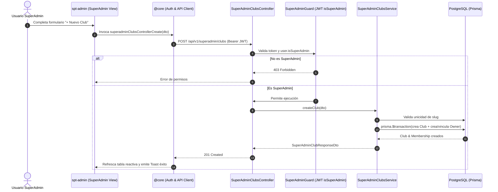

# Diseño Técnico: Módulo SuperAdmin para Alta y Gestión de Clubes (`superadmin-club-management`)

## 1. Arquitectura y Flujo de Datos



## 2. Evaluación de Riesgo en Base de Datos (Integridad y Producción)

- **Modelos existentes en `schema.prisma`:**
  - `Club`: Ya cuenta con todos los campos necesarios (`id`, `name`, `slug`, `email`, `phone`, `address`, `city`, `postalCode`, `openingHour`, `closingHour`, `slotDurationMinutes`, `paymentMode`, `isActive`).
  - `User`: Ya incluye el campo `isSuperAdmin Boolean @default(false)`.
  - `ClubMembership`: Ya incluye `clubId`, `userId`, `role` (`OWNER`, `ADMIN`, etc.).
- **Análisis de Impacto DDL:**
  - **No se requieren cambios en el esquema ni migraciones SQL.**
  - Cero riesgo de ruptura, pérdida de datos o inconsistencias en producción (**Riesgo en BBDD: NINGUNO**).
  - La lógica se implementa mediante consultas estándar de Prisma dentro de transacciones atómicas seguras.

## 3. Contratos de API y DTOs

### 3.1 DTO de Creación (`CreateClubDto`)
```typescript
export class CreateClubDto {
  @ApiProperty({ example: 'Club Deportivo Las Rozas' })
  @IsString()
  @MinLength(3)
  @MaxLength(150)
  name: string;

  @ApiProperty({ example: 'las-rozas-padel' })
  @IsString()
  @Matches(/^[a-z0-9]+(?:-[a-z0-9]+)*$/, {
    message: 'El slug debe contener solo letras minúsculas, números y guiones',
  })
  slug: string;

  @ApiProperty({ example: 'info@lasrozas.local' })
  @IsEmail()
  email: string;

  @ApiPropertyOptional({ example: '+34910000002' })
  @IsOptional()
  @IsString()
  phone?: string;

  @ApiPropertyOptional({ example: 'Calle Deportes 5' })
  @IsOptional()
  @IsString()
  address?: string;

  @ApiPropertyOptional({ example: 'Madrid' })
  @IsOptional()
  @IsString()
  city?: string;

  @ApiPropertyOptional({ example: '28230' })
  @IsOptional()
  @IsString()
  postalCode?: string;

  @ApiPropertyOptional({ example: 8, default: 8 })
  @IsOptional()
  @IsInt()
  @Min(0)
  @Max(23)
  openingHour?: number = 8;

  @ApiPropertyOptional({ example: 23, default: 23 })
  @IsOptional()
  @IsInt()
  @Min(1)
  @Max(24)
  closingHour?: number = 23;

  @ApiPropertyOptional({ example: 60, default: 60 })
  @IsOptional()
  @IsInt()
  slotDurationMinutes?: number = 60;

  @ApiPropertyOptional({ enum: PaymentMode, default: PaymentMode.PRESENTIAL })
  @IsOptional()
  @IsEnum(PaymentMode)
  paymentMode?: PaymentMode = PaymentMode.PRESENTIAL;

  @ApiPropertyOptional({ example: 'owner@lasrozas.local', description: 'Email del usuario que será asignado como OWNER del club' })
  @IsOptional()
  @IsEmail()
  ownerEmail?: string;
}
```

### 3.2 DTO de Respuesta (`SuperAdminClubResponseDto`)
```typescript
export class SuperAdminClubResponseDto {
  id: string;
  name: string;
  slug: string;
  description?: string;
  email: string;
  phone?: string;
  address?: string;
  city?: string;
  postalCode?: string;
  openingHour: number;
  closingHour: number;
  slotDurationMinutes: number;
  paymentMode: PaymentMode;
  isActive: boolean;
  facilitiesCount: number;
  membersCount: number;
  createdAt: Date;
  updatedAt: Date;
}
```

## 4. Diseño de Componentes de Frontend

### 4.1 Navegación en Shell (`spt-app`)
- En el Navbar (`app.html`), si `authService.isSuperAdmin()` es verdadero, se muestra un enlace de navegación con icono `pi pi-globe` o `pi pi-server` hacia `/admin/superadmin/clubs`.
- En el menú lateral o secundario de `spt-admin`, sección dedicada **"Plataforma / SuperAdmin"**.

### 4.2 Vista `SuperAdminClubsComponent` (`projects/spt-admin/src/app/pages/superadmin/clubs/`)
- **Cabecera:** Título `SUPERADMIN.CLUBS.TITLE`, subtítulo y botón de acción con PrimeNG `pButton`: `SUPERADMIN.CLUBS.NEW_CLUB_BTN`.
- **Filtros:** Búsqueda textual por nombre/slug y selector de estado (`Todos`, `Activos`, `Inactivos`).
- **Tabla (`p-table`):**
  - Columnas: Nombre, Slug, Ubicación (`city`), Modalidad de Pago (`p-tag`), Pistas (`facilitiesCount`), Socios (`membersCount`), Estado (`p-tag` verde/rojo) y Acciones.
  - Botones de acción: "Alternar Estado" (`pButton` con severidad condicional) y "Editar".
- **Modal de Creación (`p-dialog`):**
  - Formulario Reactivo Angular con validaciones en tiempo real.
  - Generación automática opcional de slug a partir del nombre escrito.
  - Cierre y reseteo al guardar con notificación Toast (`NotificationService.success`).

## 5. Decisiones de Arquitectura
1. **Sin `x-tenant-id` para SuperAdmin:**
   Los endpoints bajo `/api/v1/superadmin/clubs` **NO** utilizan el `TenantGuard`, ya que operan sobre la base completa de la plataforma y no sobre un inquilino específico.
2. **Generación automática con Orval:**
   El contrato OpenAPI generado se regenerará con `npm run swagger:export` y `npm run api:generate` para que `@core` exponga `SuperAdminClubsService` y sus interfaces sin duplicidades.
3. **Respeto a Directivas UI:**
   Uso exclusivo de directivas PrimeNG (`pButton`, `pInputText`, `pDropdown`, `pTable`, etc.), tokens semánticos SCSS y 100% traducciones vía `es.json`.
