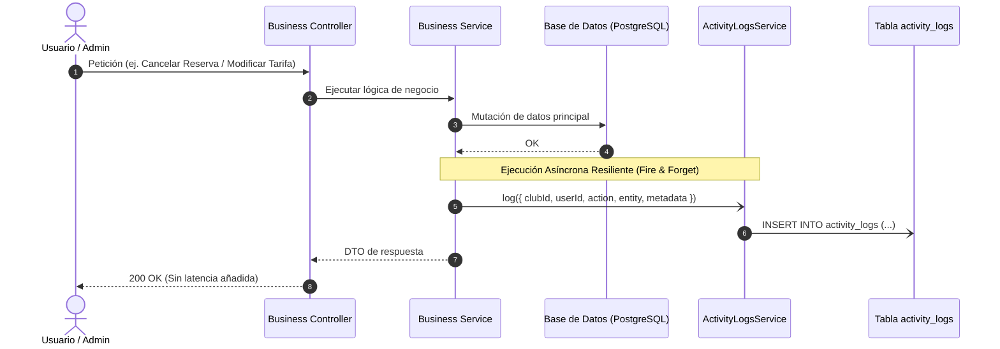

# Design: system-activity-audit-logs

**Fecha:** 2026-10-26
**Estado:** 🟡 En Diseño (Actualizado)
**Módulos:** Backend (`apps/backend/src/activity-logs/`), Frontend Admin (`apps/frontend/projects/spt-admin/`) y Frontend Portal (`apps/frontend/projects/spt-portal/`)

---

## 1. Arquitectura General y Flujo de Auditoría

El sistema de auditoría se concibe como una capa transversal y desacoplada del flujo transaccional. Utiliza un servicio especializado `ActivityLogsService` que encapsula la inserción asíncrona de eventos en la tabla `activity_logs`.



---

## 2. Evaluación de Riesgo en Base de Datos (Regla Crítica)

- **Tipo de cambio:** Totalmente **aditivo**. Se añade un nuevo modelo `ActivityLog` (tabla `activity_logs`) y un enum `ActivityAction`.
- **Impacto en tablas existentes:** Ninguno. No se alteran columnas, tipos ni restricciones en tablas operativas (`clubs`, `users`, `bookings`, `facilities`, `pricing_rules`, etc.).
- **Aislamiento Multi-Tenant:**
  - Columna `club_id` indexada en conjunto con `created_at` (`@@index([clubId, createdAt])`).
  - Para eventos transversales de plataforma (ejecutados por SuperAdmin sobre la infraestructura), `club_id` es anulable (`String?`), pero toda consulta dentro del contexto de un club exige `clubId` estrictamente en la cláusula `WHERE`.
- **Integridad referencial y cascada:**
  - Si un club se elimina, `onDelete: Cascade` limpia sus logs para evitar registros huérfanos.
  - Si un usuario se elimina, `onDelete: SetNull` preserva el historial del log con `user_id = null`, manteniendo el snapshot del nombre del usuario en el campo `metadata` para valor probatorio.
- **Riesgo Global:** 🟢 **BAJO / INEXISTENTE**. No hay riesgo de regresión ni de pérdida de datos en producción.

---

## 3. Modelo de Datos Prisma

```prisma
enum ActivityAction {
  // Reservas
  BOOKING_CREATED
  BOOKING_CANCELLED
  BOOKING_MODIFIED
  BOOKING_COMPLETED
  
  // Instalaciones y Bloqueos
  FACILITY_CREATED
  FACILITY_UPDATED
  FACILITY_DELETED
  FACILITY_BLOCK_CREATED
  FACILITY_BLOCK_DELETED
  
  // Tarifas
  PRICING_RULE_CREATED
  PRICING_RULE_UPDATED
  PRICING_RULE_DELETED
  
  // Miembros y Monedero
  MEMBER_ROLE_CHANGED
  MEMBER_WALLET_TOPUP
  MEMBER_WALLET_ADJUSTED
  MEMBER_STATUS_CHANGED
  
  // Autenticación y Seguridad
  AUTH_LOGIN_SUCCESS
  AUTH_PASSWORD_CHANGED
  AUTH_FAILED_ATTEMPT
  
  // Plataforma / SuperAdmin
  CLUB_CREATED
  CLUB_UPDATED
  CLUB_STATUS_TOGGLED
}

model ActivityLog {
  id         String         @id @default(uuid())
  clubId     String?        @map("club_id")
  userId     String?        @map("user_id")
  action     ActivityAction
  entityType String         @map("entity_type") @db.VarChar(50)
  entityId   String?        @map("entity_id") @db.VarChar(100)
  summary    String         @db.VarChar(255)
  metadata   Json?          @db.JsonB
  ipAddress  String?        @map("ip_address") @db.VarChar(45)
  userAgent  String?        @map("user_agent") @db.VarChar(255)
  createdAt  DateTime       @default(now()) @map("created_at")

  club Club? @relation(fields: [clubId], references: [id], onDelete: Cascade)
  user User? @relation(fields: [userId], references: [id], onDelete: SetNull)

  @@index([clubId, createdAt])
  @@index([clubId, entityType, entityId])
  @@index([userId, createdAt])
  @@map("activity_logs")
}
```

---

## 4. Contratos API y DTOs (NestJS / OpenAPI)

### Endpoint de Consulta Administrativa de Logs por Club
- **Ruta:** `GET /api/v1/clubs/:clubId/activity-logs`
- **Permisos:** Requiere JWT y rol `OWNER`, `ADMIN` del club, o `isSuperAdmin`.

### Endpoint de Consulta de "Mi Actividad" (Usuario Final)
- **Ruta:** `GET /api/v1/users/me/activity-logs`
- **Permisos:** Requiere JWT (cualquier usuario autenticado).
- **Filtro automático:** La consulta restringe estrictamente `userId = req.user.id` (y opcionalmente por `clubId` del club activo).

### DTOs de Petición y Respuesta
```typescript
export class QueryActivityLogsDto {
  @ApiPropertyOptional({ description: 'Página actual (1-indexed)', default: 1 })
  page?: number = 1;

  @ApiPropertyOptional({ description: 'Tamaño de página', default: 20 })
  limit?: number = 20;

  @ApiPropertyOptional({ enum: ActivityAction, description: 'Filtrar por tipo de acción' })
  action?: ActivityAction;

  @ApiPropertyOptional({ description: 'Filtrar por tipo de entidad (ej: Booking, Facility)' })
  entityType?: string;

  @ApiPropertyOptional({ description: 'Filtrar por ID de usuario ejecutor' })
  userId?: string;

  @ApiPropertyOptional({ description: 'Fecha de inicio (ISO 8601)' })
  startDate?: string;

  @ApiPropertyOptional({ description: 'Fecha de fin (ISO 8601)' })
  endDate?: string;

  @ApiPropertyOptional({ description: 'Término de búsqueda libre en summary' })
  search?: string;
}

export class ActivityLogItemDto {
  id: string;
  clubId: string | null;
  userId: string | null;
  userName?: string;
  userEmail?: string;
  action: ActivityAction;
  entityType: string;
  entityId: string | null;
  summary: string;
  metadata: Record<string, any> | null;
  ipAddress: string | null;
  createdAt: string;
}

export class ActivityLogsPaginatedResponseDto {
  data: ActivityLogItemDto[];
  total: number;
  page: number;
  limit: number;
  totalPages: number;
}
```

---

## 5. Diseño de Interfaces de Usuario (PrimeNG v22)

### 1. Panel de Administración (`spt-admin` -> `/admin/activity-logs`)
- **Filtros en cabecera:**
  - `<p-datepicker selectionMode="range">` para rango temporal.
  - `<p-select>` con categorías (`Todas`, `Reservas`, `Instalaciones`, `Tarifas`, `Miembros`, `Seguridad`).
  - `<input pInputText>` para búsqueda por texto libre.
  - `<button pButton variant="outlined"><i class="pi pi-download"></i> {{ 'ADMIN.LOGS.EXPORT_CSV' | translate }}</button>`.
- **Tabla (`p-table`):**
  - Carga diferida (`[lazy]="true"` y `(onLazyLoad)="loadLogs($event)"`).
  - Columnas: Fecha/Hora, Usuario, Acción (`p-tag`), Entidad, Resumen, Botón de inspección modal (`pi pi-eye`).
- **Modal de inspección (`p-dialog`):**
  - Detalle del evento, IP, navegador, visor de diferencias (antes vs después) y JSON estructurado.

### 2. Portal de Usuarios (`spt-portal` -> `/portal/activity`)
- **Diseño pensado para el socio:**
  - Vista limpia orientada a la experiencia de usuario (*timeline* o lista estructurada de actividad con tarjetas).
  - Pestañas rápidas con `p-tabs` o selector de categoría: "Todas", "Mis Reservas", "Monedero y Pagos", "Seguridad".
  - Indicadores visuales claros: fecha, hora, estado del movimiento y resumen amigable.
  - Diálogo simple para ver el detalle de la reserva o transacción asociada.

---

## 6. Decisiones de Rendimiento y Escalabilidad

1. **Escritura Asíncrona Resiliente:** `ActivityLogsService.log()` captura internamente cualquier error con `Logger.error()` sin interrumpir la respuesta al cliente.
2. **Índices Compuestos:** `@@index([clubId, createdAt])` y `@@index([userId, createdAt])` garantizan lecturas paginadas en milisegundos tanto para administradores como para el portal de usuarios.
3. **Exportación a CSV:** Generación en streaming o por lotes desde memoria en el frontend a partir de los datos filtrados, asegurando descarga instantánea sin sobrecargar el servidor.
