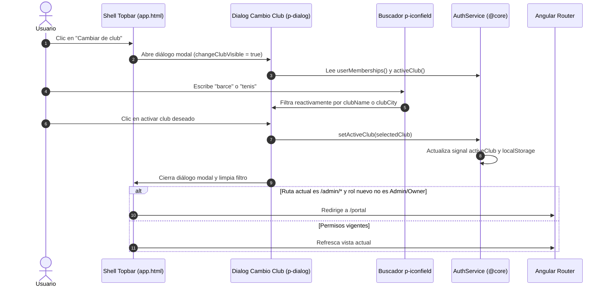

# Diseño Técnico: Selector de Club en Topbar y Modal de Cambio de Club con Buscador

## 1. Arquitectura de la Solución



---

## 2. Contratos OpenAPI y DTOs

### Backend: `apps/backend/src/auth/dto/auth-response.dto.ts`
Se añade la propiedad opcional y anulable `clubCity` al DTO de membresía:
```typescript
export class ClubMembershipSummaryDto {
  // ... campos existentes (clubId, clubName, clubSlug, role, memberNumber, walletBalance)

  @ApiPropertyOptional({
    type: String,
    example: 'Barcelona',
    nullable: true,
    description: 'Ciudad o localidad donde radica el club',
  })
  clubCity?: string | null;
}
```

### Mapeo en `apps/backend/src/auth/auth.service.ts`:
```typescript
private mapUserSummary(user: any, extraClubs: any[] = []): UserSummaryDto {
  const directMemberships = (user.memberships || [])
    .filter((m: any) => m.club && m.club.isActive)
    .map((m: any) => ({
      clubId: m.club.id,
      clubName: m.club.name,
      clubSlug: m.club.slug,
      clubCity: m.club.city ?? null,
      role: m.role,
      memberNumber: m.memberNumber,
      walletBalance: Number(m.walletBalance),
    }));

  const superAdminAdditionalMemberships = extraClubs.map((c) => ({
    clubId: c.id,
    clubName: c.name,
    clubSlug: c.slug,
    clubCity: c.city ?? null,
    role: ClubRole.OWNER,
    memberNumber: 'SUPERADMIN',
    walletBalance: 0,
  }));
  // ...
}
```

### Sincronización Frontend:
- Ejecución de `npm run api:generate` (Orval) para actualizar automáticamente las interfaces en `apps/frontend/projects/spt-app/src/app/core/api/model/clubMembershipSummaryDto.ts` y mocks.

---

## 3. Evaluación de Riesgo en Base de Datos (BBDD)

> [!NOTE]
> **Riesgo en BBDD: 0% (Sin cambios estructurales en esquemas ni migraciones).**
> El modelo Prisma `Club` en `apps/backend/prisma/schema.prisma` ya dispone del campo `city String? @db.VarChar(100)` (tal como se gestiona en Ajustes del Club).
> No se requieren migraciones SQL ni alteraciones en tablas existentes. Solo se expone un campo ya existente en el DTO de respuesta.

---

## 4. Diseño de UI y Componentes PrimeNG

### A. Modificación del Sidebar (`app.html` / `app.scss`):
- Eliminación del bloque `.sidebar-club-card`.
- Transición directa desde `.sidebar-header` a `nav.sidebar-nav`.

### B. Enriquecimiento del Topbar (`app.html` / `app.scss`):
- Contenedor `.topbar-context`:
  ```html
  <div class="topbar-context">
    @if (authService.activeClub(); as club) {
      <div class="topbar-club-info">
        <span class="context-club-name">{{ club.clubName }}</span>
        @if (club.clubCity) {
          <span class="context-club-city">
            <i class="pi pi-map-marker"></i>
            {{ club.clubCity }}
          </span>
        }
      </div>

      @if (authService.userMemberships().length > 1) {
        <button
          type="button"
          pButton
          [outlined]="true"
          size="small"
          severity="secondary"
          class="change-club-btn"
          icon="pi pi-sync"
          (click)="openChangeClubDialog()"
        >
          {{ 'USERS.CHANGE_CLUB' | translate }}
        </button>
      }
    }
  </div>
  ```

### C. Modal de Selección de Club con Buscador (`p-dialog`):
- Implementación de `p-dialog` en `app.html` con `DialogModule`:
  - **Cabecera del diálogo:** `{{ 'USERS.CHANGE_CLUB_MODAL_TITLE' | translate }}` ("Cambiar de club").
  - **Buscador integrado:**
    ```html
    <div class="modal-search-wrapper">
      <p-iconfield class="w-full">
        <p-inputicon class="pi pi-search" />
        <input
          type="text"
          pInputText
          [(ngModel)]="clubSearchTerm"
          [placeholder]="'USERS.SEARCH_CLUB_PLACEHOLDER' | translate"
          class="w-full"
        />
      </p-iconfield>
    </div>
    ```
  - **Filtrado reactivo computado (`filteredMemberships`):**
    ```typescript
    readonly clubSearchTerm = signal('');
    readonly filteredMemberships = computed(() => {
      const term = this.clubSearchTerm().trim().toLowerCase();
      const all = this.authService.userMemberships();
      if (!term) return all;
      return all.filter((m) =>
        m.clubName.toLowerCase().includes(term) ||
        (m.clubCity && m.clubCity.toLowerCase().includes(term))
      );
    });
    ```
  - **Listado de tarjetas:**
    - Borde resaltado (`border: 2px solid var(--primary-color)`) y tag `Activo` para el club actualmente seleccionado.
    - Botón `pButton` "Seleccionar" para activar clubes alternativos.
    - Estado vacío si el filtro no arroja resultados con mensaje traducido.
    - Si el club seleccionado no tiene rol administrativo y la URL actual es `/admin/*`, redirige a `/portal`.

---

## 5. Decisiones de Arquitectura y Patrones
1. **Directivas PrimeNG Obligatorias:** `pButton` para todos los botones, `pInputText`, `p-iconfield`, `p-inputicon` y `p-dialog`.
2. **Tokens de Estilo Semánticos:** Tipografías (`var(--font-size-md)`, `var(--font-weight-semibold)`), márgenes (`var(--spacing-sm)`, `var(--spacing-md)`), colores (`var(--surface-card)`, `var(--border-subtle)`).
3. **Internacionalización Integral:** Claves en `es.json` bajo la sección `USERS` (`USERS.SEARCH_CLUB_PLACEHOLDER`, `USERS.CHANGE_CLUB_MODAL_TITLE`, `USERS.NO_CLUBS_FOUND`).
