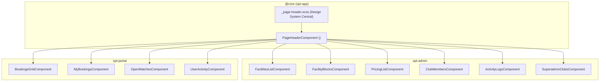

# Diseño Técnico: Unificación de Layout de Cabeceras de Páginas (Page Headers)

## 🏛️ Arquitectura de la Solución

Se define un componente UI transversal ubicado en el núcleo del Shell (`spt-app`) y expuesto a través de `@core` para su consumo inmediato en los tres microfrontends de negocio (`spt-admin`, `spt-portal`, `spt-users`).



---

## 🧩 Definición de la API del Componente (`PageHeaderComponent`)

### Declaración Standalone
- **Ruta:** `apps/frontend/projects/spt-app/src/app/core/components/page-header/page-header.component.ts`
- **Selector:** `spt-page-header`
- **Exportación:** Centralizada en `apps/frontend/projects/spt-app/src/app/core/index.ts`.

### Inputs y Tipado
```typescript
@Component({
  selector: 'spt-page-header',
  standalone: true,
  imports: [CommonModule, RouterModule, TranslateModule, TagModule, ButtonModule],
  templateUrl: './page-header.component.html',
  styleUrls: ['./page-header.component.scss'],
  changeDetection: ChangeDetectionStrategy.OnPush,
})
export class PageHeaderComponent {
  /** Título principal de la cabecera (texto traducido o clave) */
  @Input({ required: true }) title!: string;

  /** Subtítulo o texto descriptivo secundario */
  @Input() subtitle?: string;

  /** Icono de PrimeNG opcional antes del título (ej: 'pi pi-calendar', 'pi pi-history') */
  @Input() icon?: string;

  /** Ruta de retorno opcional para navegación jerárquica (ej: '/admin/facilities') */
  @Input() backUrl?: string;

  /** Texto o clave del enlace de retorno (ej: 'ADMIN.BLOCKS.BACK_TO_FACILITIES') */
  @Input() backLabel?: string;

  /** Badge opcional de contexto o entidad (ej: '— Pista 1 Central') */
  @Input() badgeText?: string;

  /** Severidad visual del badge opcional */
  @Input() badgeSeverity: 'success' | 'info' | 'warn' | 'danger' | 'secondary' | 'contrast' = 'info';
}
```

### Slots de Proyección (`ng-content`)
1. `<ng-content select="[actions]"></ng-content>`: Acciones primarias y botones (`pButton`).
2. `<ng-content select="[filters]"></ng-content>`: Controles de filtrado contextual o selectores auxiliares.
3. `<ng-content></ng-content>`: Proyección por defecto en el área derecha si no se especifican selectores.

---

## 🎨 Maquetación y Tokens del Design System

### Plantilla HTML del Componente
```html
<header class="page-header" role="banner">
  <div class="header-titles">
    @if (backUrl) {
      <div class="breadcrumbs-back">
        <a [routerLink]="backUrl" class="back-link">
          <i class="pi pi-arrow-left"></i>
          <span>{{ backLabel || ('COMMON.BACK' | translate) }}</span>
        </a>
      </div>
    }

    <div class="title-row">
      @if (icon) {
        <i [class]="icon + ' header-icon'"></i>
      }
      <h1 class="page-title">{{ title }}</h1>
      @if (badgeText) {
        <p-tag [value]="badgeText" [severity]="badgeSeverity" class="header-badge" />
      }
    </div>

    @if (subtitle) {
      <p class="page-subtitle">{{ subtitle }}</p>
    }
  </div>

  <div class="header-actions">
    <ng-content select="[filters]"></ng-content>
    <ng-content select="[actions]"></ng-content>
    <ng-content></ng-content>
  </div>
</header>
```

### Estilos SCSS Centralizados (`_page-header.scss`)
```scss
@use "../base/variables" as *;
@use "../base/responsive" as *;

.page-header {
  display: flex;
  align-items: center;
  justify-content: space-between;
  margin-bottom: var(--spacing-lg);
  gap: var(--spacing-md);
  flex-wrap: wrap;

  @include mobile {
    flex-direction: column;
    align-items: stretch;
    gap: var(--spacing-sm);
  }

  .header-titles {
    display: flex;
    flex-direction: column;
    gap: var(--spacing-2xs);

    .breadcrumbs-back {
      margin-bottom: var(--spacing-2xs);

      .back-link {
        display: inline-flex;
        align-items: center;
        gap: var(--spacing-xs);
        color: var(--text-muted);
        font-size: var(--font-size-sm);
        text-decoration: none;
        transition: color var(--theme-transition);

        &:hover {
          color: var(--primary-color);
        }
      }
    }

    .title-row {
      display: flex;
      align-items: center;
      gap: var(--spacing-xs);
      flex-wrap: wrap;

      .header-icon {
        font-size: var(--font-size-xl);
        color: var(--primary-color);
      }

      .page-title {
        font-family: var(--font-heading);
        font-size: var(--font-size-xl);
        font-weight: var(--font-weight-bold);
        color: var(--text-color);
        letter-spacing: -0.02em;
        margin: 0;
      }

      .header-badge {
        font-size: var(--font-size-xs);
      }
    }

    .page-subtitle {
      font-family: var(--font-body);
      font-size: var(--font-size-sm);
      color: var(--text-muted);
      margin: 0;
    }
  }

  .header-actions {
    display: flex;
    align-items: center;
    gap: var(--spacing-sm);
    flex-wrap: wrap;

    @include mobile {
      width: 100%;
      justify-content: stretch;

      button, p-select {
        flex: 1;
      }
    }
  }
}
```

---

## 🛡️ Evaluación de Riesgo en Base de Datos
- **Impacto en BD:** **CERO (0%)**.
- No se introducen ni modifican entidades de Prisma, migraciones SQL, esquemas de endpoints ni reglas multi-tenant. Es un cambio puramente estructural y visual de frontend.

---

## 🔄 Plan de Migración de Vistas por Fases
1. **Fase 1:** Creación del componente `PageHeaderComponent` en `@core` y definición de estilos en el Design System.
2. **Fase 2:** Migración de vistas administrativas principales (`facilities-list`, `facility-blocks`, `pricing-list`, `club-members`, `superadmin-clubs`).
3. **Fase 3:** Migración de vistas de auditoría (`activity-logs` en admin y `user-activity` en portal), eliminando la duplicación en `p-card`.
4. **Fase 4:** Migración de vistas de reservas en portal (`bookings-grid`, `my-bookings`, `open-matches`).
5. **Fase 5:** Limpieza de reglas SCSS redundantes en cada microfrontend y validación de suites de pruebas unitarias.
