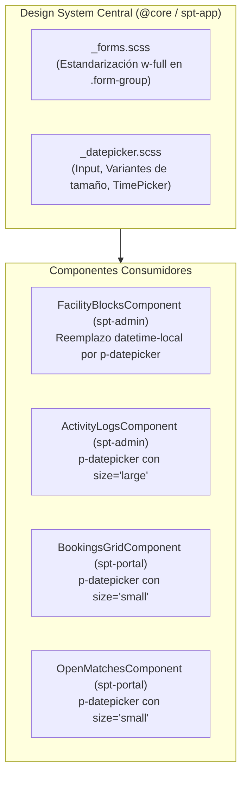

# Diseño Técnico: Unificación Global de Estilos y Componente DatePicker

## 1. Arquitectura y Componentes Afectados



## 2. Evaluación de Riesgo en Base de Datos
- **Riesgo en BBDD:** NINGUNO (0/10).
- **Justificación:** Este cambio no modifica esquemas Prisma, migraciones ni bases de datos. Los endpoints consumen strings ISO 8601 (`startTime`, `endTime`) que se generan tanto a partir de objetos `Date` como de cadenas válidas.

## 3. Especificación de Estilos del Design System

### 3.1 `_forms.scss`
Incorporar regla universal para DatePicker similar a `p-select` y `p-inputnumber`:
```scss
.form-group .p-datepicker,
.form-group p-datepicker,
.modal-form .p-datepicker,
.modal-form p-datepicker,
.facility-form .p-datepicker,
.pricing-form .p-datepicker,
.block-form .p-datepicker,
.p-datepicker.w-full,
p-datepicker.w-full {
  width: 100% !important;
  display: flex;
}
```

### 3.2 `_datepicker.scss`
Estandarizar:
1. Input `.p-datepicker-input`:
   - `height: 42px` (por defecto en form inputs)
   - `border-radius: var(--radius-md)`
   - `border: 1px solid var(--border-input)`
   - Hover / Focus rings con Stitch Neon Pink (`var(--primary-color)`).
2. Variantes de tamaño:
   - `[size="small"]` / `.p-datepicker-sm`: `height: 36px`, `font-size: var(--font-size-xs)`.
   - `[size="large"]` / `.p-datepicker-lg`: `height: 48px`, `font-size: var(--font-size-base)`.
3. Controles de tiempo `.p-datepicker-time-picker`:
   - Contenedor con `border-top: 1px solid var(--border-subtle)`
   - Botones `.p-datepicker-increment-button` y `.p-datepicker-decrement-button` con hover `var(--primary-color)`.

## 4. Cambios en `facility-blocks.component.html` y `.ts`
- Importar `DatePickerModule` en `FacilityBlocksComponent`.
- Sustituir `<input type="datetime-local">` por `<p-datepicker [showTime]="true" hourFormat="24" dateFormat="dd/mm/yy" [showIcon]="true" iconDisplay="input" [appendTo]="'body'" class="w-full" styleClass="w-full">`.
- En `blockForm`: Inicializar `startTime` y `endTime` a `null` al resetear el formulario.
