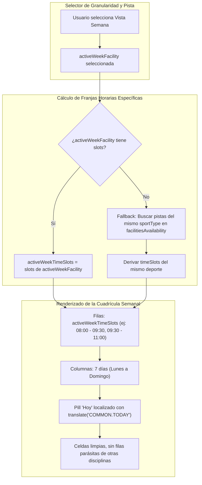

# Design: Alineación de Rangos de Tiempo en Vista Semana de Reservas

**Fecha:** 2026-10-27  
**Estado:** 🟡 Borrador  

---

## 1. Diagrama de Flujo y Arquitectura



---

## 2. Contratos de API (OpenAPI)

El endpoint existente de backend `GET /api/v1/facilities/availability` ya expone el modelo completo `FacilityAvailabilityResponseDto`:

```yaml
/api/v1/facilities/availability:
  get:
    summary: Obtener matriz de disponibilidad por pistas
    parameters:
      - name: date
        in: query
        required: true
        schema:
          type: string
          example: '2026-10-27'
      - name: sportType
        in: query
        required: false
        schema:
          $ref: '#/components/schemas/SportType'
    responses:
      '200':
        description: Listado de pistas con sus franjas horarias y slots de disponibilidad
        content:
          application/json:
            schema:
              type: array
              items:
                $ref: '#/components/schemas/FacilityAvailabilityResponseDto'
```

No se requieren modificaciones en los contratos OpenAPI ni en los DTOs del backend.

---

## 3. Modelos de Datos Afectados

No hay alteraciones en el esquema de Prisma (`schema.prisma`).

---

## 4. Riesgo de Base de Datos

| Riesgo | Nivel | Mitigación |
| :--- | :---: | :--- |
| Pérdida o alteración de datos | 🟢 Nulo | La solución opera puramente en la capa de presentación del frontend (microfrontend `spt-portal`), sin consultas destructivas ni migraciones en PostgreSQL. |
| Inconsistencia multi-tenant | 🟢 Nulo | El contexto del tenant (`club_id`) se preserva mediante los headers y tokens vigentes. |

---

## 5. Diseño UI y Experiencia de Usuario (UX)

### Antes (Comportamiento anómalo)
* La columna lateral de horas mezclaba franjas de 30 min (squash), 60 min (tenis/fútbol) y 90 min (pádel).
* En una pista de pádel de 90 minutos se mostraban 8 franjas horarias fragmentadas entre las 08:00 y las 11:00 (`08:00-08:30`, `08:00-09:00`, `08:00-09:30`, `08:30-09:00`, etc.), con celdas vacías (`—`) en la mayoría de horas.
* La cabecera mostraba el texto crudo `PORTAL.BOOKINGS.TODAY`.

### Después (Comportamiento homologado con Vista Día)
* **Cadencia homogénea:** Si la pista activa es de pádel (90 min), las filas horarias son exclusivamente:
  * `08:00 - 09:30`
  * `09:30 - 11:00`
  * `11:00 - 12:30`
  * `12:30 - 14:00`
  * ...
* **Alineación con Vista Día:** Cada fila representa una unidad de reserva real y completa de la instalación elegida.
* **Internacionalización:** El pill del día actual muestra "Hoy" de forma limpia y estilizada.

---

## 6. Decisiones Técnicas

1. **Getter Dedicado `activeWeekTimeSlots` frente a `uniqueTimeSlots`:**
   * *Decisión:* Mantener `uniqueTimeSlots` si es necesario para otros contextos globales, pero definir `activeWeekTimeSlots` como fuente de verdad para la tabla semanal.
   * *Justificación:* Permite aislar la lógica temporal de la pista activa sin provocar efectos secundarios en otras vistas.

2. **Estrategia de Fallback Seguro:**
   * Si la pista seleccionada no devolviera slots para una fecha específica (por ejemplo, por festivo o mantenimiento completo), el sistema consultará las pistas hermanas de su mismo `sportType` para proyectar las franjas horarias esperadas, evitando que la cuadrícula se renderice vacía.

3. **Corrección de Clave i18n:**
   * En `bookings-grid.component.html`, actualizar la plantilla para consumir `'COMMON.TODAY' | translate` o registrar `'PORTAL.BOOKINGS.TODAY'` en `es.json` con valor `"Hoy"`. Se aplicará ambas medidas para máxima robustez.
